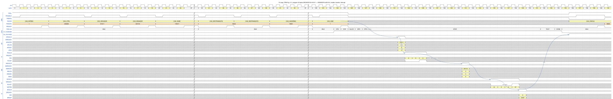

# AXI DMA Controller

A multi-channel **AXI5 DMA controller** written in SystemVerilog, with the programmers model and interfaces of the
Arm CoreLink DMA-350, a complete **UVM verification environment** built on AMBA verification IPs,
and a **performance analysis**. The documentation explains every operation of the design with waveforms that were
produced by simulating this RTL.

<p align="center">
  <a href="docs/waveform/svg/copy_1d.svg"></a>
</p>

*One complete 1D copy, taken from the RTL simulation: the CPU programs the registers over APB (left), enables the
channel, the FSM runs, data flows `AR → R → AW → W → B`, and the interrupt rises (right). Click to zoom.
[Chapter 3 of the waveform guide](docs/waveform/03_data_transfers.md) explains it cycle by cycle.*

## Start here – how to read this repository

If you want to **understand the design**, read in this order:

| Step | Read | What you learn |
|---|---|---|
| 1 | [Design overview](docs/waveform/01_design_overview.md) | what the DMA does, block diagram, command life cycle, the FIFO rules, timing constants |
| 2 | [Waveform guide](docs/waveform/README.md) (chapters 2 – 10) | every operation from the first APB write to the interrupt: copy, burst splitting, 2D / wrap / fill, command linking, restart, autoboot, triggers, AXI-Stream, pause / stop, errors, arbitration, GPO, low power |
| 3 | [Architecture](docs/architecture.md) | features, parameters, micro-architecture of each block, SRAM and timing notes |
| 4 | [Consistency report](docs/waveform/11_consistency_report.md) | how the waveforms were cross-checked against the TRM, the RTL and 395 automatic protocol checks |
| 5 | [Verification](docs/verification.md), [Performance](docs/perf_report.md), [Bug list](docs/bug_list.md), [CDC](docs/cdc.md) | test plan and coverage, measured throughput, bugs found and fixed, clock-domain crossings |

The full documentation index is in [docs/README.md](docs/README.md).

## Features

| Feature | Implementation |
|---|---|
| Channels | 1–8, each with its own byte-granular data FIFO (`CH_FIFO_DEPTH[n]` words) |
| Bus | AXI5 manager M0, optional M1; 32 / 64 / 128-bit data, 32–64-bit address |
| Programming | APB4 subordinate, Secure / Non-secure / privileged register frames |
| Commands | 1D and 2D, `continue` / `wrap` / `fill`, templates, unaligned addresses, burst shaping (1 KB, `MAXBURSTLEN`, FIFO/2) |
| Command linking | descriptors in memory with a header bitmap, auto-restart, autoboot |
| Triggers | hardware, software and internal triggers; command mode, DMA- and peripheral-driven flow control; trigger output |
| AXI-Stream | optional per channel: stream in, stream out, in & out through an external engine |
| Control | pause, resume, stop, disable, all-channel control, CTI halt / restart |
| Errors | bus, configuration, trigger-selection and stream errors reported in `CH_ERRINFO` |
| Low power | Q-Channel (clock) and P-Channel (power) |

## Repository layout

```
.
├── rtl/                     RTL (file list: rtl/dma_rtl.f, ${DMA_ROOT} = repository root)
│   ├── dma_top.sv           top level, parameters, ports of the TRM
│   ├── dma_biu.sv, ...      bus interface unit, APB front end, unit control, LPI, trigger matrix
│   ├── ch/                  one DMA channel: FSM, register frame, address generators, FIFO, link, triggers
│   └── common/              FIFO storage primitive, register slices, arbiter, synchronizers
├── tb/
│   ├── uvm/                 UVM test bench: top, env, sequences, one test class per file (tests/)
│   └── smoke/               small stand-alone smoke bench (no UVM)
├── scripts/                 run_sim.py (build / run / regression), coverage and performance reports
├── docs/
│   ├── README.md            documentation index
│   ├── waveform/            operation-by-operation guide with 41 simulation waveforms (start here)
│   └── architecture.md, verification.md, perf_report.md, cdc.md, bug_list.md, ...
├── vip_src/                 the AMBA verification IPs used by the test bench (APB, AXI5, AXI4-Stream)
└── references/              where to get the Arm TRM (the PDF is not redistributed)
```

## Quick start

Requirements: QuestaSim 10.7c (`QUESTA_BIN`, default `C:/questasim64_10.7c/win64`), UVM 1.2 sources
(`UVM_SRC`), Python 3. Simulation results go to `sim/` (not tracked by git).

```
python scripts/run_sim.py build                                   # compile RTL + UVM test bench
python scripts/run_sim.py run -t dma_smoke_test                   # one test case
python scripts/run_sim.py run -t dma_dir_1d_test --wave           # keep a waveform database

python scripts/run_sim.py regress -l tb/uvm/regress/regress_list.txt \
       --variants default,d32,d128,a40,min,nosec,ch8,nosync       # sign-off regression (8 builds)
python scripts/run_sim.py regress -l tb/uvm/regress/regress_cov_all.txt --cov
python scripts/cov_report.py sim/regress/<stamp>                  # code coverage per design unit
python scripts/run_sim.py regress -l tb/uvm/regress/regress_perf.txt --variants default,d32,d128
python scripts/perf_report.py sim/regress/<stamp> -o docs/perf_results.md
python scripts/gen_flat_top.py --name dma_ctrl --num-ch 4 --ti 4 --to 4 --stream-mask 0x03 --m1 1 -o rtl/gen/dma_ctrl.sv
```

At most 12 compile / simulation jobs run in parallel (`MAX_JOBS` in `scripts/run_sim.py`).
To regenerate the waveforms of the documentation see [docs/waveform/README.md](docs/waveform/README.md#reproduce-the-figures).

## Status

| Item | Result |
|---|---|
| Sign-off regression, 8 builds | 296 / 296 passed |
| Functional coverage (`cg_cmd`, `cg_axi`, `cg_event`) | 100 % |
| RTL code coverage (default build) | statement 98.5 %, branch 95.5 %, FSM states 100 % ([details](docs/verification.md#63-rtl-code-coverage-merged-default-build)) |
| RTL bugs found by verification | 15, all fixed with regression tests ([bug list](docs/bug_list.md)) |
| Performance (64-bit bus) | 9-cycle command start, 6-cycle completion, up to 94–97 % of the bus with tuned bursts ([report](docs/perf_report.md)) |
| Protocol / spec checks on the documented waveforms | 395 checks, 0 violations ([report](docs/waveform/11_consistency_report.md)) |

Not covered here (see [docs/verification.md](docs/verification.md) §7): structural CDC / lint with dedicated tools,
synthesis and STA, gate-level simulation, a real SRAM-macro build (`MEM_IMPL = 1`).

## Third-party material

* **Arm CoreLink DMA-350 Technical Reference Manual** – the specification this design follows. It is
  copyrighted by Arm and is **not** included; see [references/README.md](references/README.md).
* **AMBA verification IPs** (APB, AXI5, AXI4-Stream) in [`vip_src/`](vip_src/README.md) – from the author's
  [Common-Verification-IP-Library](https://github.com/mrDonf/Common-Verification-IP-Library), plus one small local
  addition documented in `vip_src/README.md`.
