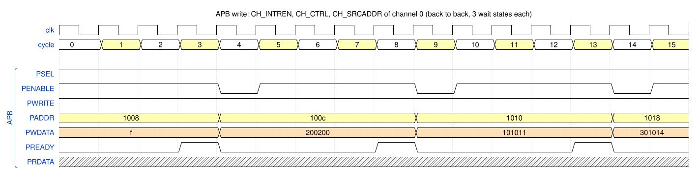
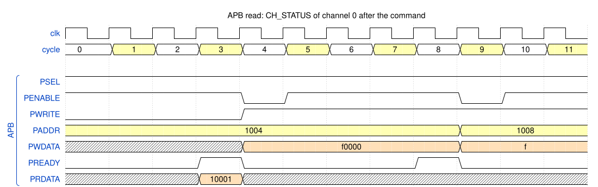
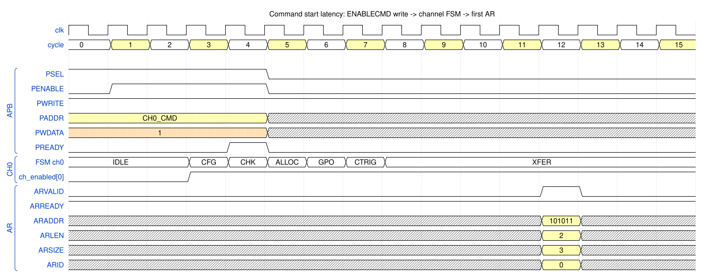

# 2. Register access and command start

The CPU talks to the DMA only through the **APB4 subordinate port**. This chapter shows what one APB write
and one APB read look like on the DMA pins, and how long it takes from the `ENABLECMD` write until the first
AXI read. Test case: `dma_dir_1d_test` (first command, TRM Fig. 5-1). Figure conventions:
[README](README.md#how-to-read-the-figures).

## 2.1 APB write

**What the interface does** (`rtl/dma_apb_if.sv`, TRM 4.2):

* only 32-bit accesses; a write with `PSTRB` other than `4'b1111` gets `PSLVERR`; `PADDR[1:0]` is ignored;
* `PPROT` selects privilege / security (accesses with too low rights read as zero and ignore writes);
* the access is **captured in the first access cycle**, **executed one clock later** from registered
  address and data (short timing paths), and answered with a **registered `PREADY`**.

*Figure `apb_write` – source: [`wavejson/apb_write.json`](wavejson/apb_write.json).*

Three back-to-back writes of the first command (channel 0 frame at `0x1000`):

| Completion cycle | `PADDR` | Register | `PWDATA` | Meaning |
|---|---|---|---|---|
| 3 | `0x1008` | `CH_INTREN` | `0xF` | enable the interrupts DONE, ERR, DISABLED, STOPPED |
| 8 | `0x100C` | `CH_CTRL` | `0x200200` | `TRANSIZE` = 0 (byte), `XTYPE` = 1 (continue), `DONETYPE` = 1 (default) |
| 13 | `0x1010` | `CH_SRCADDR` | `0x101011` | source address |

Each access takes **5 cycles**:

1. **setup** (1 cycle): `PSEL` = 1, `PENABLE` = 0, `PADDR`, `PWRITE`, `PWDATA` valid;
2. **access** (4 cycles): `PENABLE` = 1; `PREADY` = 0 for **3 wait-state cycles**, then `PREADY` = 1 in the fourth,
   which completes the access.

The next access starts in the cycle after `PREADY`, with `PSEL` staying high. A complete command needs about
24 register writes, so programming takes roughly 120 cycles. This is why command linking
([Chapter 5](05_command_linking_restart_autoboot.md)) is faster for many small commands.

The three wait states are a property of this implementation, not of the TRM; every access in all simulations
of this folder has exactly 3 (checked automatically).

## 2.2 APB read and clearing the status

*Figure `apb_read` – source: [`wavejson/apb_read.json`](wavejson/apb_read.json).*

After the command has finished, the CPU reads `CH_STATUS` and clears the flags:

| Cycle | Access | Value | Meaning |
|---|---|---|---|
| 3 | read `CH0_STATUS` (`0x1004`) | `PRDATA` = `0x10001` | `STAT_DONE` (bit 16) and its interrupt flag `INTR_DONE` (bit 0) are set |
| 8 | write `CH0_STATUS` | `0xF0000` | write-1-to-clear of `STAT_DONE / ERR / DISABLED / STOPPED` (bits 19:16); `irq_channel[0]` falls |

`PRDATA` is valid only in the cycle where `PREADY` = 1. The interrupt output `irq_channel[0]` falls in the
last cycle of the write access: the status register was already updated while the access was waiting.

## 2.3 Start of a command

Writing `CH_CMD` with `ENABLECMD` (bit 0) starts the channel. All other registers were written before.

*Figure `start_latency` – source: [`wavejson/start_latency.json`](wavejson/start_latency.json).*

| Cycle | Event |
|---|---|
| 3 | `ch_enabled[0]` ↑ and FSM `CFG`. The write was executed inside the APB access, so the output changes one cycle before `PREADY`. |
| 4 | `CH0_CMD` write completes on APB; FSM `CHK` (register value checks) |
| 5 | `ALLOC` (no hardware trigger → nothing to allocate) |
| 6 | `GPO` (no GPO configured) |
| 7 | `CTRIG` (no command trigger → passes at once) |
| 8 | `XFER`: the address generators start |
| 12 | first `AR` handshake: `ARADDR` = `0x101011`, `ARLEN` = 2, `ARSIZE` = 3, `ARID` = 0 |
| 13–15 | three `R` beats (`RLAST` in 15) |

**Start latency = 9 cycles** from `ch_enabled` ↑ (cycle 3) to the first `AR` (cycle 12); 17 cycles for 2D
commands because of the `MUL` state ([Chapter 4](04_2d_wrap_fill.md)). The latency is the price of a fully
registered pipeline: snapshot of the registers, checks, address generator with registered state, a 2-entry AR queue,
and a register slice in the BIU, so that all AXI outputs come straight from flip-flops.

**After `ENABLECMD`** the configuration registers are read-only and are updated by hardware while the command
runs (the address registers point to the next transfer, the size registers count down). Only `CH_CMD`,
`CH_STATUS` and `CH_WRKREGPTR` can still be written (TRM 5.6).
