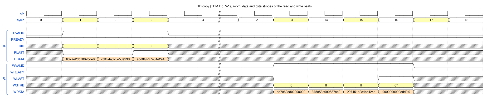
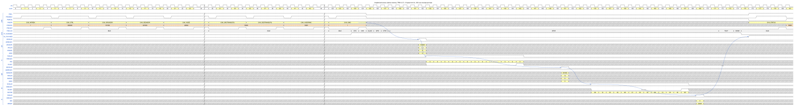
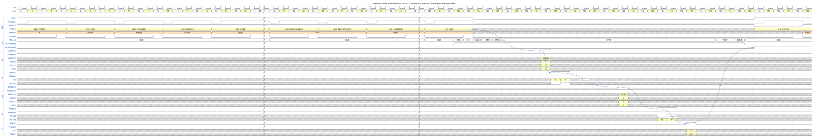
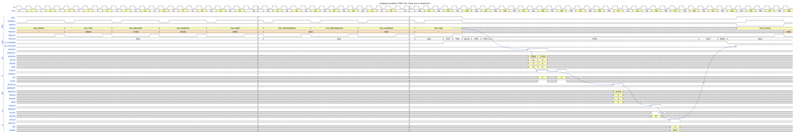
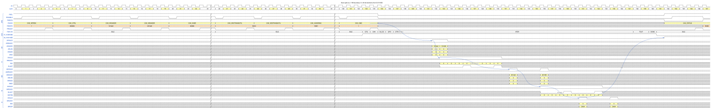
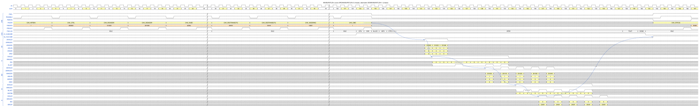
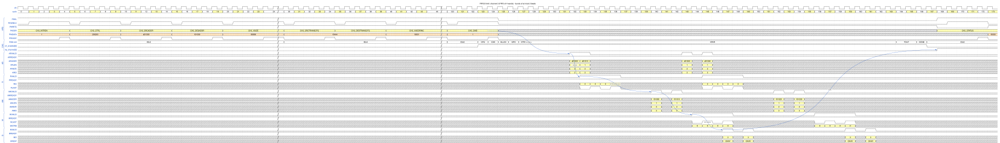

# 3. Data transfers: 1D copy and burst shaping

This chapter follows a plain **1D copy** from the first APB write to the interrupt, then shows how the DMA
decides the **size and length of every AXI burst**. Test cases: `dma_dir_1d_test` and `dma_dir_burst_test`.
Figure conventions: [README](README.md#how-to-read-the-figures).

## 3.1 1D copy of 23 bytes (TRM Fig. 5-1)

A **1D transfer** copies `XSIZE` elements from `SRCADDR` to `DESADDR`. The element size is `2^TRANSIZE` bytes
(here 1 byte). The addresses are deliberately **not aligned to the 8-byte bus** and differ from each other, so the
DMA has to shift the bytes between source and destination lanes.

*Figure `copy_1d` – source: [`wavejson/copy_1d.json`](wavejson/copy_1d.json).*

### Configure

| Register | Offset | Value | Meaning |
|---|---|---|---|
| `CH_INTREN` | `0x08` | `0xF` | enable interrupts DONE, ERR, DISABLED, STOPPED |
| `CH_CTRL` | `0x0C` | `0x200200` | `TRANSIZE` = 0 (8-bit elements), `CHPRIO` = 0, `XTYPE` = 1 (continue), `YTYPE` = 0 (1D), `DONETYPE` = 1 |
| `CH_SRCADDR` | `0x10` | `0x00101011` | source start (lane 1 of the word at `0x101010`) |
| `CH_DESADDR` | `0x18` | `0x00301014` | destination start (lane 4 of the word at `0x301010`) |
| `CH_XSIZE` | `0x20` | `0x00170017` | `SRCXSIZE` = `DESXSIZE` = 23 elements = 23 bytes |
| `CH_SRCTRANSCFG` | `0x28` | `0x000F0444` | `MEMATTR` = `0x44` (normal memory), non-secure, `SRCMAXBURSTLEN` = 15 (up to 16 beats) |
| `CH_DESTRANSCFG` | `0x2C` | `0x000F0444` | same for the destination |
| `CH_XADDRINC` | `0x30` | `0x00010001` | both sides increment by 1 element |
| `CH_CMD` | `0x00` | `0x1` | `ENABLECMD` |

The testbench also writes all other registers with their reset value; the figure keeps only the writes that matter
(`//` marks the rest).

### Walk-through

| Cycle | Where | What happens |
|---|---|---|
| 4, 9, 14, 19, 24 | APB | `INTREN`, `CTRL`, `SRCADDR`, `DESADDR`, `XSIZE` (5 cycles each) |
| 30–44 | APB | `SRCTRANSCFG`, `DESTRANSCFG`, `XADDRINC` |
| 124 | APB | `CH_CMD` = 1 (`ENABLECMD`) |
| 123–128 | FSM | `CFG`, `CHK`, `ALLOC`, `GPO`, `CTRIG`, `XFER` ([Chapter 2](02_register_access_and_start.md)) |
| 132 | `AR` | `ARADDR` = `0x101011`, `ARLEN` = 2 (3 beats), `ARSIZE` = 3 (8 bytes), `ARID` = 0 |
| 133–135 | `R` | 3 beats, `RLAST` in 135 |
| 141 | `AW` | `AWADDR` = `0x301014`, `AWLEN` = 3 (4 beats), `AWSIZE` = 3, `AWID` = 0 |
| 145–148 | `W` | 4 beats, `WSTRB` = `f0`, `ff`, `ff`, `07`, `WLAST` in 148 |
| 149 | `B` | `BRESP` = OKAY |
| 152, 154 | FSM | `TOUT`, `DONE` |
| 155 | `ch_enabled[0]` ↓ | the channel is free again (FSM `IDLE`) |
| 156 | `irq_channel[0]` ↑ | `DONE` interrupt |
| 160 | APB | the CPU reads `CH_STATUS` = `0x10001` |

### Why it looks like this

* **Three read beats, four write beats.** The 23 source bytes cover 7 + 8 + 8 bytes of three bus words
  (lanes 1–7 of word `0x101010`, all of `0x101018`, all of `0x101020`). The destination starts at lane 4, so the
  same 23 bytes cover 4 + 8 + 8 + 3 bytes of four words – hence `WSTRB` = `f0`, `ff`, `ff`, `07`.
* **The write waits for the data.** The last `R` beat is at cycle 135 but `AW` only at 141. A write burst is issued
  only when its **complete data is already in the FIFO**, and data becomes "available" only after it passed the
  3-stage FIFO write pipeline. Because of this rule `W` beats are never stalled by the DMA, and reads and writes can
  never deadlock each other.
* **`W` follows `AW`.** The first `W` beat is 4 cycles after `AW`: the BIU pushes the channel into its W-order
  queue when the `AW` handshake completes on the bus, so `W` can never overtake `AW` (TRM 4.3.3).
* **The interrupt follows the end of the command.** `B` (149) → `TOUT` (152) → `DONE` (154) → `ch_enabled` ↓ (155)
  → `irq_channel` ↑ (156). **6 cycles** from the last `B` until the channel is idle.
* The arrows `a → g` in the figure connect these events in cause-and-effect order.

## 3.2 Byte lanes: what happens to the data

*Figure `copy_1d_data` (zoom of the same transfer; cycle 0 = the `AR`) – source:
[`wavejson/copy_1d_data.json`](wavejson/copy_1d_data.json).*

| Beat | Data (64 bit) | `WSTRB` | Lanes used |
|---|---|---|---|
| `R0` | `637ae2dd7062dde6` | – | source byte 0 = lane 1 (`dd`) … lane 7 |
| `R1` | `cd424a375e53e990` | – | all 8 bytes |
| `R2` | `edd0f9297451e2e4` | – | all 8 bytes |
| `W0` | `dd7062dd00000000` | `f0` | lanes 4–7 = source bytes 0–3 (`dd 62 70 dd`) |
| `W1` | `375e53e990637ae2` | `ff` | source bytes 4–11 |
| `W2` | `297451e2e4cd424a` | `ff` | source bytes 12–19 |
| `W3` | `0000000000edd0f9` | `07` | lanes 0–2 = source bytes 20–22 (`f9 d0 ed`) |

Read as a byte stream the 23 source bytes `dd 62 70 dd e2 7a 63 90 e9 53 5e 37 4a 42 cd e4 e2 51 74 29 f9 d0 ed` are
**identical** to the 23 bytes written. The DMA moved every byte three lanes to the left (source lane 1 → destination
lane 4). The FIFO is a byte-granular circular buffer: a rotator packs incoming beats at the write pointer, and a
funnel shifter places the outgoing bytes on any destination lane (`dma_ch_fifo.sv`). Lanes outside `WSTRB` carry
no meaning.

## 3.3 Beat size: unoptimized and optimized accesses (TRM 4.3.6 – 4.3.8)

The DMA can issue a burst in two ways:

* **Unoptimized** – `AxSIZE` = `TRANSIZE`: one element per beat regardless of the bus width.
* **Optimized** – the beats are widened to the bus width and `WSTRB` selects the valid bytes. It is allowed only
  for **normal memory** (`MEMATTR[7:4]` ≠ 0), **unit address increment** and **no template** on that side.
  On the read side the burst is widened only when it contains enough data to reach bus alignment or already starts
  aligned; otherwise the largest size that stays inside the command is used.

The TRM illustrates this with three examples; the simulation reproduces all of them beat by beat.

### Example A – unaligned start, unoptimized (TRM Fig. 4-1)

13 bytes (`XSIZE` = 13) from `0x101003` to `0x301003`, **device memory** (`MEMATTR` = `0x00`, so
`CH_SRCTRANSCFG` = `CH_DESTRANSCFG` = `0x000F0400`).

*Figure `unopt_unaligned` – source: [`wavejson/unopt_unaligned.json`](wavejson/unopt_unaligned.json).*

| Cycle | Event |
|---|---|
| 132 | one `AR`: `ARADDR` = `0x101003`, `ARLEN` = 12 (13 beats), `ARSIZE` = 0 (1 byte) |
| 133–145 | 13 `R` beats |
| 151 | one `AW`: `AWADDR` = `0x301003`, `AWLEN` = 12, `AWSIZE` = 0 |
| 155–167 | 13 `W` beats with `WSTRB` = `08 10 20 40 80 01 02 04 08 10 20 40 80`: the strobe **walks across the lanes**, one byte per beat |
| 169, 175, 176 | `B`; `ch_enabled` ↓; `irq_channel` ↑ |

Bus utilization is 1/8 on every beat, exactly as the TRM states for the unoptimized case.

### Example B – unaligned start, optimized (TRM Fig. 4-2)

Same 13 bytes, **normal memory** (`MEMATTR` = `0x44`).

*Figure `opt_unaligned` – source: [`wavejson/opt_unaligned.json`](wavejson/opt_unaligned.json).*

| Cycle | Event |
|---|---|
| 132 | one `AR`: `ARADDR` = `0x101003` (**unaligned address is used as is**), `ARLEN` = 1, `ARSIZE` = 3 |
| 133–134 | 2 `R` beats: lanes 3–7 (5 bytes) then 8 bytes |
| 140 | one `AW`: `AWADDR` = `0x301003`, `AWLEN` = 1, `AWSIZE` = 3 |
| 144, 145 | 2 `W` beats: `WSTRB` = `f8` (5 bytes), `ff` (8 bytes) |

Two beats instead of 13 for the same data. For reads the subordinate ignores the lower byte lanes; for writes
`WSTRB` selects the used lanes. The first beat has utilization (8 − 3) / 8 as in the TRM.

### Example C – unaligned end (TRM Figs. 4-4 and 4-5)

3 bytes (`XSIZE` = 3) from the aligned address `0x101000` to `0x301000`, normal memory.

*Figure `opt_unaligned_end` – source: [`wavejson/opt_unaligned_end.json`](wavejson/opt_unaligned_end.json).*

| Cycle | Event |
|---|---|
| 132 | `AR` `0x101000`, `ARLEN` = 0, **`ARSIZE` = 1** (16-bit beat: 2 bytes) |
| 133 | `AR` `0x101002`, `ARLEN` = 0, **`ARSIZE` = 0** (8-bit beat: 1 byte) |
| 141 | one `AW` `0x301000`, `AWLEN` = 0, `AWSIZE` = 3 |
| 145 | one `W` beat with `WSTRB` = `07` |

The read side cannot read a full word because only 3 bytes belong to the command, so it uses the largest power of two
that fits (2 bytes), then 1 byte – "the first burst uses 16-bit access, while the second only 8-bit" (TRM 4.3.8).
The write side can always use the full bus width with strobes (utilization 3/8).

The decision is made in `dma_ch_agen.sv`: `i_opt` is the normal-memory flag (`MEMATTR[7:4]` ≠ 0); the read
side widens the burst only if the unaligned head or the length allows it.

## 3.4 Splitting a transfer into bursts

Besides the beat size, the generator decides the **number of beats**. Each burst is limited by the smallest of:

| Limit | Source |
|---|---|
| end of the current line (1D: the whole transfer) | command size |
| source wrap point, data / fill boundary (Chapter 4) | `XTYPE` |
| remaining elements of a trigger block (Chapter 6) | `SRCTRIGINBLKSIZE` |
| `MAXBURSTLEN` + 1 beats | `CH_SRCTRANSCFG` / `CH_DESTRANSCFG` bits 19:16 |
| **FIFO/2** in bytes | channel FIFO size (TRM 4.3.6) |
| the next **1 KB boundary** | TRM 4.3.6, "never crosses 1 KB" |

Source and destination are limited **independently**, so a transfer can be read with fewer bursts than it is written.

### 3.4.1 Split at a 1 KB boundary

64 bytes (8 elements of 64 bit, `TRANSIZE` = 3) from `0x1013E0` to `0x3013E0`. Configure: `CH_CTRL` = `0x200203`,
`CH_SRCADDR` = `0x1013E0`, `CH_DESADDR` = `0x3013E0`, `CH_XSIZE` = `0x80008`, `TRANSCFG` = `0xF0444`.

*Figure `burst_1kb` – source: [`wavejson/burst_1kb.json`](wavejson/burst_1kb.json).*

| Cycle | Event |
|---|---|
| 124 | `CH_CMD` = 1 |
| 132 | `AR` `0x1013E0`, `ARLEN` = 3: 4 beats up to `0x1013FF` |
| 133 | `AR` `0x101400`, `ARLEN` = 3: the second burst starts **exactly at the 1 KB boundary** |
| 133–140 | 8 `R` beats (`RLAST` in 136 and 140) |
| 142, 146 | `AW` `0x3013E0` and `AW` `0x301400`, each `AWLEN` = 3 |
| 146–153 | 8 `W` beats, `WLAST` in 149 and 153 |
| 151, 155 | the two `B` responses |
| 158, 160, 161, 162 | `TOUT`, `DONE`, `ch_enabled` ↓, `irq_channel` ↑ |

The 64 bytes would run past `0x101400`, so the read side (and independently the write side) is cut at the boundary.
This is required so that the DMA can be connected to AHB-style infrastructure that does not allow 1 KB crossings.

### 3.4.2 `MAXBURSTLEN`

10 elements of 64 bit, with `SRCMAXBURSTLEN` = 3 (`CH_SRCTRANSCFG` = `0x30444`, at most 4 beats) and
`DESMAXBURSTLEN` = 1 (`CH_DESTRANSCFG` = `0x10444`, at most 2 beats). `CH_XSIZE` = `0xA000A`.

*Figure `burst_maxlen` – source: [`wavejson/burst_maxlen.json`](wavejson/burst_maxlen.json).*

| Cycle | Event |
|---|---|
| 132, 133, 134 | `AR` `0x101000` (`ARLEN` 3), `0x101020` (3), `0x101040` (1): 4 + 4 + 2 = 10 beats |
| 140, 142, 144, 146, 148 | `AW` `0x301000`, `0x301010`, `0x301020`, `0x301030`, `0x301040`, each `AWLEN` = 1 |
| 144–153 | 10 `W` beats (`WLAST` every second beat) |
| 147, 149, 151, 153, 155 | five `B` responses |

The register field is *maximum beats − 1*: the maximum number of beats is `MAXBURSTLEN` + 1 (TRM, `CH_SRCTRANSCFG`).
The same data is read in 3 bursts and written in 5.

### 3.4.3 The FIFO/2 limit

Channel 3 has the smallest FIFO (4 words = 32 bytes). `CH_XSIZE` = `0x80008` (8 elements of 64 bit),
`MAXBURSTLEN` = 15 on both sides, source `0xD01000`, destination `0xF01000` (`CH_CTRL` = `0x200203`).

*Figure `burst_fifo2` – source: [`wavejson/burst_fifo2.json`](wavejson/burst_fifo2.json).*

| Cycle | Event |
|---|---|
| 132, 133 | `AR` `0xD01000`, `0xD01010`, `ARLEN` = 1: bursts are cut to **2 beats = FIFO/2**, although `MAXBURSTLEN` would allow 16 |
| 133–136 | 4 `R` beats fill the FIFO completely (4 words) |
| 140, 142 | `AW` `0xF01000`, `0xF01010` |
| 143, 145 | **only now** the next two `AR` (`0xD01020`, `0xD01030`): space was freed when the data of the first write burst started to leave the FIFO |
| 144–147 | first 4 `W` beats; `B` in 147 and 149 |
| 152, 154 | `AW` `0xF01020`, `0xF01030` |
| 156–159 | last 4 `W` beats; `B` in 159 and 161 |
| 164, 166, 167, 168 | `TOUT`, `DONE`, `ch_enabled[3]` ↓, `irq_channel[3]` ↑ |

With a FIFO of F bytes, bursts of at most F/2 let **one half be written while the other half is read** (double
buffering). The read of the next burst waits until there is room for the whole response, and `ARID` / `AWID` = 3 here
because the transfer runs on channel 3. The performance consequences (efficiency versus FIFO size and
`MAXBURSTLEN`) are measured in [`docs/perf_report.md`](../perf_report.md).
