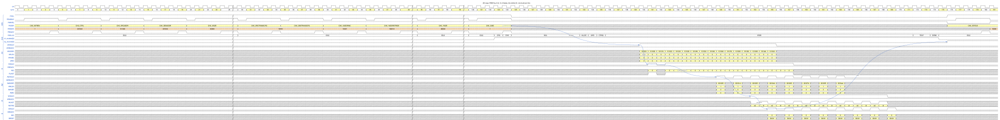
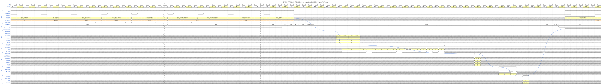
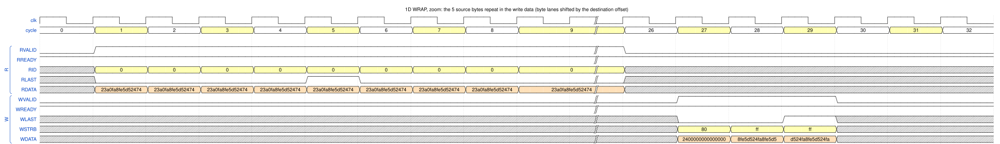
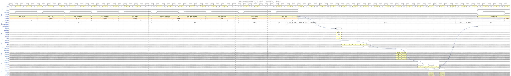
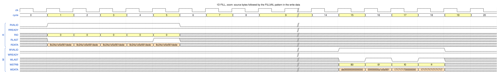

# 4. 2D transfers, WRAP and FILL

Chapter 3 moved one contiguous block. This chapter shows the **extended commands**: copying a rectangle
(**2D**), repeating the source (**WRAP**) and padding the destination with a constant (**FILL**).
Test cases: `dma_dir_2d_test` and `dma_dir_wrap1d_test`. Figure conventions:
[README](README.md#how-to-read-the-figures).

## 4.1 2D copy (TRM Fig. 5-5)

A **2D** command copies `YSIZE` lines of `XSIZE` elements. The start of each line is `YADDRSTRIDE` bytes after the
start of the previous line, independently on both sides (so the DMA can copy a window out of an image, or between
images with different pitch). Setting `CH_CTRL.YTYPE` = 1 (continue) makes the command 2D. Negative strides and
increments mirror, rotate or transpose an image (TRM Fig. 5-7; they are covered by `dma_dir_2d_test` but not
drawn here).

*Figure `copy_2d` – source: [`wavejson/copy_2d.json`](wavejson/copy_2d.json).*

### Configure

| Register | Value | Meaning |
|---|---|---|
| `CH_CTRL` | `0x201200` | like Chapter 3 plus **`YTYPE` = 1** (bits 14:12) |
| `CH_SRCADDR` / `CH_DESADDR` | `0x101003` / `0x301005` | start addresses, both unaligned |
| `CH_XSIZE` | `0x90009` | 9 elements (bytes) per line, source and destination |
| `CH_YSIZE` | `0x80008` | 8 lines |
| `CH_YADDRSTRIDE` | `0x180018` | line pitch 24 bytes on both sides |
| `CH_XADDRINC` | `0x10001` | 1 element |
| `CH_SRCTRANSCFG`, `CH_DESTRANSCFG` | `0xF0444` | normal memory (optimized accesses allowed) |

These are exactly the parameters of TRM Fig. 5-5 (X size 9, Y size 8, stride 0x18).

### Walk-through

| Cycle | Event |
|---|---|
| 124 | `CH_CMD` = 1 |
| 123–136 | FSM `CFG`, `CHK`, **`MUL` (125–132)**, `ALLOC`, `GPO`, `CTRIG`, `XFER` |
| 140–155 | 16 `AR` bursts, **two per line**, one per cycle: `0x101003` (size 3, one 8-byte beat covering lanes 3–7 = 5 bytes) and `0x101008` (size 2, one 4-byte beat); the next line adds the stride: `0x10101B`, `0x101020`, `0x101033`, `0x101038`, … |
| 149, 151, 153, … | 8 `AW`, one per line, `AWLEN` = 1: `0x301005`, `0x30101D`, `0x301035`, `0x30104D`, `0x301065`, `0x30107D`, `0x301095`, `0x3010AD` (stride 24) |
| 153 onwards | 16 `W` beats: for every line `WSTRB` = `e0` (3 bytes, lanes 5–7) then `3f` (6 bytes, lanes 0–5) – together the 9 bytes of the line |
| 172, 174, 175, 176 | `TOUT`, `DONE`, `ch_enabled` ↓, `irq_channel` ↑ |

### Why it looks like this

* **`MUL` takes 8 cycles.** The total element count (X size × Y size, up to 32 × 16 bit) is computed by an
  iterative radix-4 multiplier, one step per cycle, instead of a large combinational multiplier. This is why the 2D
  start latency is **17 cycles** instead of 9.
* **A burst never crosses a line.** The address generator splits the command into *lines* and shapes bursts inside a
  line. A line of 9 bytes starting at lane 3 needs a first beat that reaches the bus alignment (5 bytes) and a
  second beat for the rest (4 bytes, the largest size that fits). The read side therefore issues two single-beat
  bursts per line; the write side combines the 9 bytes in one 2-beat burst per line.
* **One `AW` per line** is issued as soon as the 9 bytes of that line are in the FIFO; the write side runs behind
  the read side and the lines overlap in time.

## 4.2 WRAP and FILL: different source and destination sizes

When `SRCXSIZE` and `DESXSIZE` differ, `CH_CTRL.XTYPE` decides what happens (TRM 5.2.1 – 5.2.2):

| Case | `XTYPE` = continue (1) | `XTYPE` = wrap (2) | `XTYPE` = fill (3) |
|---|---|---|---|
| `SRCXSIZE` = `DESXSIZE` | normal 1D copy | same | same |
| `SRCXSIZE` > `DESXSIZE` | stops when the destination is full; extra source data is dropped | same | same |
| `SRCXSIZE` < `DESXSIZE` | copies `SRCXSIZE` elements, then stops | the source is **read again from its start** until `DESXSIZE` elements are written | the rest of the destination is filled with **`FILLVAL`** |
| `SRCXSIZE` = 0, `DESXSIZE` > 0 | nothing | nothing | writes only: the destination is filled |
| `SRCXSIZE` > 0, `DESXSIZE` = 0 | reads only (useful with stream out) | same | same |

Both examples below use `SRCXSIZE` = 5 bytes, `DESXSIZE` = 17 bytes, source `0x101521`, destination `0x301547`
(`CH_XSIZE` = `0x110005`), byte elements, normal memory. The only differences from a 1D copy are `XTYPE` and,
for FILL, `CH_FILLVAL`.

### 4.2.1 WRAP

`CH_CTRL` = `0x200400` (**`XTYPE` = 2**).

*Figure `wrap_1d` – source: [`wavejson/wrap_1d.json`](wavejson/wrap_1d.json).*

| Cycle | Event |
|---|---|
| 124 | `CH_CMD` = 1; `XFER` in 128 |
| 132, 133, 134 | three `AR` to **the same address** `0x101521`, `ARLEN` = 4, `ARSIZE` = 0 (5 byte beats each) |
| 135 | fourth `AR` `0x101521`, `ARLEN` = 1 (the last 2 bytes): 5 + 5 + 5 + 2 = **17 reads** |
| 155 | one `AW` `0x301547`, `AWLEN` = 2 (3 beats): issued only when all 17 bytes are in the FIFO |
| 159–161 | `W` beats, `WSTRB` = `80`, `ff`, `ff` (1 + 8 + 8 bytes) |
| 163 | `B` |
| 168, 169, 170 | `DONE`, `ch_enabled` ↓, `irq_channel` ↑ |

*Figure `wrap_1d_data` (zoom: cycle 0 = first `AR`; the first 9 of the 17 `R` beats, then the 3 `W` beats) – source:
[`wavejson/wrap_1d_data.json`](wavejson/wrap_1d_data.json).*

Every `R` beat returns the same 64-bit word `23a0fa8fe5d52474` (all five source bytes lie in the word at
`0x101520`; the byte to use is selected by the beat address). The 5 source bytes are `24 d5 e5 8f fa`. The write
beats are `2400000000000000` (`WSTRB` `80`: first byte at `0x301547`), `8fe5d524fa8fe5d5` and `d524fa8fe5d524fa`,
i.e. the pattern `24 d5 e5 8f fa` repeated until 17 bytes are written.

*The DMA reads the source several times* – the source must not change during the command (TRM 5.2.2). The source
burst is cut at every wrap point, which is why there are four `AR` for 17 bytes.

### 4.2.2 FILL

`CH_CTRL` = `0x200600` (**`XTYPE` = 3**), `CH_FILLVAL` = `0xA5C39617`.

*Figure `fill_1d` – source: [`wavejson/fill_1d.json`](wavejson/fill_1d.json).*

| Cycle | Event |
|---|---|
| 124 | `CH_CMD` = 1 |
| 132 | **one** `AR` `0x101521`, `ARLEN` = 4 (5 bytes): the source is read once |
| 133–137 | 5 `R` beats |
| 143 | `AW` `0x301547`, `AWLEN` = 1: the **data part** (1 + 4 bytes) |
| 144 | `AW` `0x30154C`, `AWLEN` = 1: the **fill part** (4 + 8 bytes) |
| 147–150 | 4 `W` beats, `WSTRB` = `80`, `0f`, `f0`, `ff` |
| 149, 151 | the two `B` responses |
| 156, 157, 158 | `DONE`, `ch_enabled` ↓, `irq_channel` ↑ |

*Figure `fill_1d_data` (zoom: 5 `R` beats, then 4 `W` beats) – source:
[`wavejson/fill_1d_data.json`](wavejson/fill_1d_data.json).*

The source word is `8c24a1e5e561dede`; the 5 source bytes from `0x101521` are `de 61 e5 e5 a1`. The write beats are
`de00000000000000` (`80`), `00000000a1e5e561` (`0f`, bytes `61 e5 e5 a1`), `1717171700000000` (`f0`) and
`1717171717171717` (`ff`): after the 5 data bytes follow **12 fill bytes `0x17`**. With byte elements the fill value
is `FILLVAL[7:0]` = `0x17`, repeated; for larger elements the matching low bytes of `FILLVAL` are used.

### Why it looks like this

* **Reads once, writes 17.** With FILL the number of reads equals `SRCXSIZE` and the fill data is generated inside the
  DMA (`dma_ch_rdeng.sv` replicates the fill pattern), so no extra reads happen. With WRAP the read count equals
  `DESXSIZE`.
* **Data and fill are separate bursts.** The write generator splits the destination at the **data / fill boundary**
  (`dma_ch_agen.sv`): the first burst is taken from the FIFO, the second burst only carries the pattern and does not
  wait for source data.
* The same machinery handles `DESXADDRINC` = 0 (writing into a FIFO register): the source is repeated, or the fill
  value is written last (TRM 5.2.2, covered by `dma_dir_wrap1d_test`).
