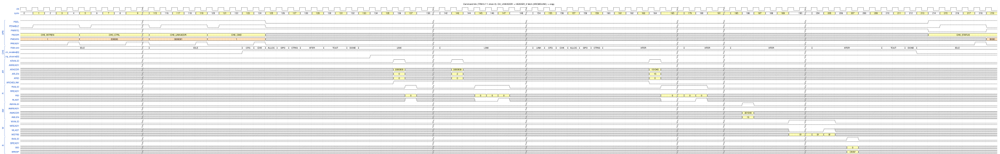
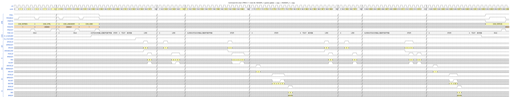
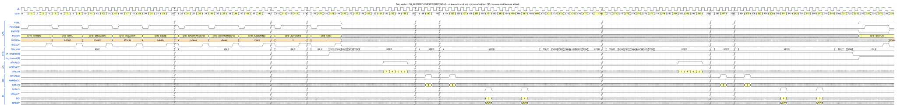
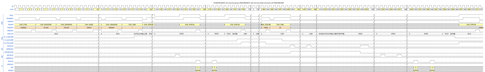
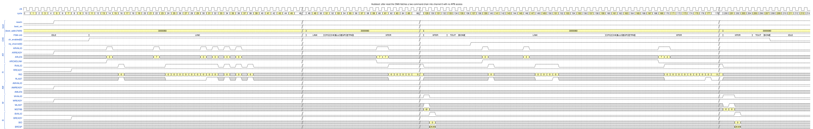

# 5. Command linking, automatic restart and autoboot

Programming a command over APB costs about 120 cycles ([Chapter 2](02_register_access_and_start.md)). Three
features let the DMA run **sequences of commands without the CPU**:

* **command linking** – the next command is fetched from memory (a *descriptor*),
* **automatic restart** – the same command is repeated,
* **autoboot** – the first command chain is fetched right after reset.

Test cases: `dma_dir_link_test`, `dma_restart_test`, `dma_dir_done_test`, `dma_autoboot_test`.
Figure conventions: [README](README.md#how-to-read-the-figures).

## 5.1 Command linking

### How it works

1. The first command is written to the channel registers by the CPU (it may be an **empty command**, `XTYPE` = 0,
   that only points to the first real command).
2. When a command finishes (`DONE`) and `LINKADDREN` (`CH_LINKADDR` bit 0) is set, the channel enters state `LINK`
   and fetches the descriptor at `LINKADDR` over the normal AXI read port.
3. A descriptor is an array of 32-bit words. **Word 0 is a header**: bit *n* set means "the next word is the new value
   of the register at offset 4·*n*". The words follow in the order of the header bits (LSB first).
   Bit 0 (`REGCLEAR`) first resets all linkable registers to their reset values.
4. The registers are written one per cycle; then the channel goes to `CFG` and runs the new command.
5. A descriptor that clears `LINKADDREN` ends the chain.

Header bits used in this chapter (TRM Table 5-12; the full table has one bit per register):

| Bit | Register | Bit | Register |
|---|---|---|---|
| 0 | `REGCLEAR` | 8 | `CH_XSIZE` |
| 2 | `CH_INTREN` | 10 | `CH_SRCTRANSCFG` |
| 3 | `CH_CTRL` | 11 | `CH_DESTRANSCFG` |
| 4 | `CH_SRCADDR` | 30 | `CH_LINKADDR` |
| 6 | `CH_DESADDR` | | |

Link fetches look different from data reads on the bus (TRM 4.3.9, 5.7.2): `ARCMDLINK` = 1, `ARPROT[2]` = 1
(instruction access), `ARID` = channel number, the beat size is the bus width and the burst type is INCR. The
security and privilege state of the channel is used.

### Chain A: empty command → complete descriptor (`HEADER_0`)

The descriptor at `0x03000000` is `HEADER_0` = `0x0D5D` = bits 0, 2, 3, 4, 6, 8, 10, 11: `REGCLEAR` plus 7 registers
(`INTREN`, `CTRL`, `SRCADDR`, `DESADDR`, `XSIZE`, `SRCTRANSCFG`, `DESTRANSCFG`). It was written into memory by the
testbench, not over APB.

*Figure `cmd_link` – source: [`wavejson/cmd_link.json`](wavejson/cmd_link.json).*

**Configure over APB** (only three registers matter):

| Register | Value | Meaning |
|---|---|---|
| `CH_INTREN` | `0xF` | interrupts on |
| `CH_CTRL` | `0x200000` | `XTYPE` = 0: **empty command** |
| `CH_LINKADDR` | `0x3000001` | descriptor at `0x03000000`, `LINKADDREN` = 1 |
| `CH_CMD` | `0x1` | `ENABLECMD` |

**Walk-through:**

| Cycle | Event |
|---|---|
| 119, 124 | `CH_LINKADDR` and `CH_CMD` writes |
| 123–132 | `CFG`, `CHK`, `ALLOC`, `GPO`, `CTRIG`, `XFER` (2 cycles, no bus access), `TOUT`, `DONE` for the **empty command** |
| 133 | FSM `LINK` |
| 134 | `irq_channel[0]` ↑: the empty command is "done" and `CH_INTREN` = `0xF`, so it raises `DONE` (kept high, not cleared in this figure) |
| 136 | `AR` `0x3000000`, `ARLEN` = 0, **`ARCMDLINK` = 1**: reads the **header beat** (8 bytes = `HEADER_0` + the first register word) |
| 137 | the header beat returns |
| 143 | `AR` `0x3000008`, `ARLEN` = 2, `ARCMDLINK` = 1: the **body** (3 beats = 6 words), requested after the header was decoded |
| 145–147 | the body returns; the decoder writes one register per cycle |
| 155–160 | `CFG` … `XFER` of the loaded command |
| 164 | `AR` `0x101040`, `ARLEN` = 15, `ARSIZE` = 2: 16 beats of 4 bytes, **FIXED** burst, `ARCMDLINK` = 0 (data read) |
| 165–180 | 16 `R` beats |
| 186 | `AW` `0x301040`, `AWLEN` = 15, `AWSIZE` = 2 |
| 190–205 | 16 `W` beats (`WSTRB` = `f`) |
| 207, 210, 212, 213 | `B`, `TOUT`, `DONE`, `ch_enabled[0]` ↓ |

**Why it looks like this**

* **Why the second read is separate.** The number of words depends on the header, so the DMA first fetches one
  beat (the header and the words that share it), decodes it, then requests exactly the remaining words (INCR bursts
  up to 16 beats, never across 1 KB, limited by the free space of the 16-word command buffer).
* **Why the data burst is FIXED.** `XADDRINC` is not in the header, so `REGCLEAR` set it to 0 (no increment) on both
  sides: the 16 elements are read from one address and written to one address, like a peripheral FIFO. That is a
  property of `HEADER_0` of the TRM example, not of linking.
* **The loaded command runs exactly like a CPU-programmed one**, including checks (`CHK`). An invalid header
  (all zero, or reserved bits 1, 23, 25, 27 set) stops the channel with `LINKHDRERR` + `CFGERR`
  ([Chapter 9](09_error_handling.md)).

### Chain B: partial updates (`HEADER_1` → `HEADER_2`)

Descriptors usually change only a few registers. Here the first command is again empty and points at `HEADER_1`
(`0x40000158` = bits 3, 4, 6, 8, 30: `CTRL`, `SRCADDR`, `DESADDR`, `XSIZE`, `LINKADDR`) which links to `HEADER_2`
(`0x40000140` = bits 6, 8, 30: only `DESADDR`, `XSIZE`, `LINKADDR`). `REGCLEAR` is **not** set, so everything not in
the header keeps its old value.

*Figure `cmd_link_chain` – source: [`wavejson/cmd_link_chain.json`](wavejson/cmd_link_chain.json).*

Configure: `CH_INTREN` = `0xF`, `CH_CTRL` = `0x200000`, `CH_LINKADDR` = `0x3000021` (descriptor `HEADER_1` at `0x3000020`).

| Cycle | Event |
|---|---|
| 123–133 | empty command, then `LINK` |
| 136, 143 | link reads of `HEADER_1`: `AR` `0x3000020` (`ARLEN` 0: header + `CTRL`) and `AR` `0x3000028` (`ARLEN` 1: `SRCADDR`, `DESADDR`, `XSIZE`, `LINKADDR`) |
| 153–158 | `CFG` … `XFER` of the **first real command** (24 byte elements) |
| 162 | `AR` `0x101200`, `ARLEN` = 2 (24 bytes) |
| 171, 179 | `AW` `0x301300` (`AWLEN` 2), `B` |
| 182, 184, 185 | `TOUT`, `DONE`, `LINK` (the link address was loaded by `HEADER_1`) |
| 188, 195 | link reads of `HEADER_2`: `AR` `0x3000038` and `AR` `0x3000040` (each `ARLEN` 0) |
| 203–208 | `CFG` … `XFER` of the **second command** (10 bytes) |
| 212 | `AR` `0x101218`: the source continues **right after the first block** (`0x101200` + 24) |
| 221, 227 | `AW` `0x301500` (the new `DESADDR` from `HEADER_2`), `B` |
| 230, 232, 233 | `TOUT`, `DONE`, `ch_enabled[0]` ↓ |

The source address was **not** in `HEADER_2`. The address registers always hold the *next* address after a command
(TRM 5.6.4), so the second command automatically continues where the first one stopped. `HEADER_2` loads
`LINKADDR` = 0, which clears `LINKADDREN` and ends the chain.

## 5.2 Automatic restart

A command that must be repeated many times (for example filling a buffer cyclically) does not need to be
re-programmed: `CH_AUTOCFG.CMDRESTARTCNT` repeats it that many times, or forever with `CMDRESTARTINFEN`.
`CH_CTRL.REGRELOADTYPE` decides which registers are **reloaded with their initial values** before each repeat:

| `REGRELOADTYPE` | Reloaded before a restart |
|---|---|
| `000` | nothing (addresses continue, sizes are 0 → empty repeats) |
| `001` | source and destination sizes |
| `011` | source address + sizes |
| `101` | destination address + sizes |
| `111` | source and destination addresses + sizes |

*Figure `auto_restart` – source: [`wavejson/auto_restart.json`](wavejson/auto_restart.json).*

**Configure**

| Register | Value | Meaning |
|---|---|---|
| `CH_CTRL` | `0x3C0200` | `XTYPE` = 1, **`REGRELOADTYPE` = 7**, `DONETYPE` = 1 |
| `CH_SRCADDR` / `CH_DESADDR` | `0x1044F2` / `0x303C3D` | unaligned |
| `CH_XSIZE` | `0x6D006D` | 109 bytes |
| `CH_SRCTRANSCFG` / `CH_DESTRANSCFG` | `0xB0444` / `0xD0444` | `MAXBURSTLEN` 11 / 13 |
| `CH_AUTOCFG` | `0x3` | `CMDRESTARTCNT` = 3 → **1 + 3 = 4 executions** |

**Walk-through.** Each execution is identical and takes **50 cycles** (`CFG` to `DONE`):

| Execution | `CFG` | `DONE` |
|---|---|---|
| 1 | 123 | 172 |
| 2 | 173 | 222 |
| 3 | 223 | 272 |
| 4 | 273 | 322 |

The figure shows execution 1, the start of execution 2, a gap, and execution 4. In each execution the same four
reads (`AR` `0x1044F2` `ARLEN` 7, `0x104530` 4, `0x104558` 0, `0x10455C` 2) and two writes (`AW` `0x303C3D` `AWLEN` 8,
`0x303C7D` 6) occur, because the addresses and sizes are reloaded.

* At `DONE` of executions 1–3 the FSM goes straight to `CFG`; **`ch_enabled` stays high**. A restart reaches its
  first `AR` 9 cycles after `CFG` (cycle 173 → 182), the same pipeline as a fresh start, but without any APB access.
* With `DONETYPE` = 1 (end of command) **`STAT_DONE` and the interrupt appear once**, after the last execution:
  `ch_enabled` ↓ at 323, `irq_channel` ↑ at 324. With `DONETYPE` = 3 (end of each restart cycle) `STAT_DONE` would be
  set after every execution (see `dma_dir_done_test`).

## 5.3 Pausing at the end of a command: `DONEPAUSEEN`

If `CH_CTRL.DONEPAUSEEN` = 1, the channel **pauses after `STAT_DONE`** and waits for `RESUMECMD` before it starts
the restart or the next linked command. That gives the CPU a chance to inspect results or change memory between the
commands of a chain. On the *last* command of a chain it has no effect.

*Figure `done_pause` – source: [`wavejson/done_pause.json`](wavejson/done_pause.json).*

**Configure** (first command: a 128-byte copy that links to a second command whose descriptor is at `0x3000000`):
`CH_CTRL` = `0x1200203` (`DONEPAUSEEN` = bit 24, `TRANSIZE` = 3, `DONETYPE` = 1), `CH_SRCADDR` = `0x101C00`,
`CH_DESADDR` = `0x301C00`, `CH_XSIZE` = `0x100010`, `CH_LINKADDR` = `0x3000001`.

| Cycle | Event |
|---|---|
| 119 | `CH_CMD` = 1; `XFER` follows (the copy runs) |
| 162 | last `B` of the first command |
| 165, 167 | `TOUT`, `DONE` |
| 168 | **`ch_paused[0]` ↑**; the FSM is in `LINK` but does **not** fetch: it is frozen (`STAT_PAUSED` + `STAT_RESUMEWAIT`) |
| 169 | `irq_channel[0]` ↑ (`STAT_DONE`); the CPU polls `CH_STATUS` |
| (gap, about 320 cycles) | **no bus traffic while paused**; `ch_enabled` stays 1 |
| 494 | CPU clears `STAT_DONE` (`CH_STATUS` ← `0x10000`); `irq_channel[0]` ↓ |
| 498, 499 | `ch_paused[0]` ↓, `CH_CMD` ← `0x20` (`RESUMECMD`) completes |
| 500, 508 | link reads of the next descriptor: `AR` `0x3000000`, `AR` `0x3000008` |
| 519–524 | `CFG` … `XFER` of the second command |
| 528, 543, 560 | `AR` `0x101E00`, `AW` `0x301E00`, `B` |
| 563, 565, 566, 567 | `TOUT`, `DONE`, `ch_enabled` ↓, `irq_channel` ↑ |

The channel stays enabled while paused (TRM 5.6) and keeps its trigger state. The write that *clears* `STAT_DONE`
is separate from the `RESUMECMD` write: the first acknowledges the interrupt, the second restarts the chain.

## 5.4 Autoboot

**Autoboot** lets the DMA run a command chain **right after reset, before the CPU has configured anything**
(TRM 5.7.3, 5.10). The integrator ties the static inputs `boot_en` = 1, `boot_addr` (word address of the first
descriptor) and `boot_memattr` / `boot_shareattr`; they must be stable when reset is released.

*Figure `autoboot` – source: [`wavejson/autoboot.json`](wavejson/autoboot.json). There is **no APB traffic**.*

| Cycle | Event |
|---|---|
| 0–5 | reset asserted; `boot_en` = 1 and the boot descriptor address `0x3000080` are already applied |
| 5 | `resetn` ↑ (released) |
| 11 | `ch_enabled[0]` ↑ and FSM `LINK`: once both LPI channels (Q and P) are in their active state, 6 cycles after reset release, channel 0 starts as an **empty command whose link address is `boot_addr`** |
| 14 | `AR` `0x3000080`, `ARLEN` = 0, `ARCMDLINK` = 1: header of the **first boot descriptor** |
| 22 | `AR` `0x3000088`, `ARLEN` = 7: the body; further `AR` follow as the 16-word command buffer drains (the descriptor sets all registers) |
| 51–56 | `CFG` … `XFER` of the first command; copy runs |
| 133, 135 | `TOUT`, `DONE` |
| 136, 137 | `LINK`, `irq_channel[0]` ↑ (done of the first command) |
| 139, 146 | `AR` `0x3000180` (header) and `AR` `0x3000188` (`ARLEN` 3): the **second** descriptor, linked by the first |
| 160–165 | `CFG` … `XFER` of the second command |
| 205, 207, 208 | `TOUT`, `DONE`, `ch_enabled[0]` ↓ |
| 213 | the CPU can now read `CH_STATUS` (APB access) |

Autoboot is implemented with the command-link unit: `boot_start` (= both LPI channels active, `boot_en` set, once after reset; `dma_top.sv`) moves channel 0 from `IDLE` directly to `LINK`
(`dma_channel.sv`), so everything in this section is the same hardware as Section 5.1. Channel 0 is Secure when the
security extension is present, so the boot descriptors must be in Secure memory.
