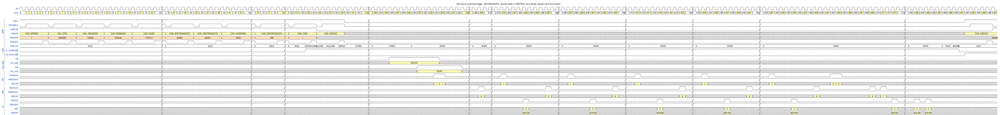
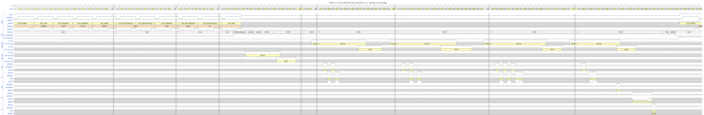
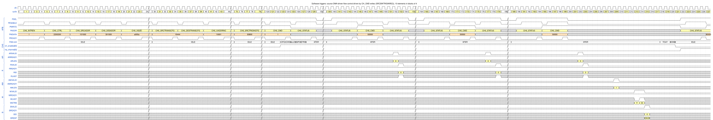
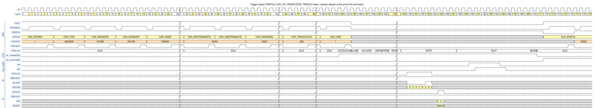
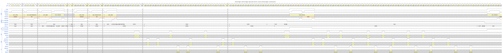

# 6. Triggers

Triggers synchronize a DMA command with **peripherals, software or other DMA channels** without CPU polling.
A peripheral says "I have data" or "I can take data", and the DMA starts, or continues, accordingly.
Test cases: `dma_trig_cmd_test`, `dma_dir_trig_test`, `dma_dir_trig_sw_test`.
Figure conventions: [README](README.md#how-to-read-the-figures).

## 6.1 Concepts

### The 4-phase handshake

Trigger inputs and outputs use a **4-phase** `req` / `ack` handshake, which also works across clock domains
(the input side has a 2-flop synchronizer, `dma_cdc_sync`):

```
 req  ____/‾‾‾‾‾‾‾‾‾‾‾‾\____
 ack  _________/‾‾‾‾‾‾‾‾‾‾‾\____       1. req ↑   2. ack ↑   3. req ↓   4. ack ↓
```

`trig_in_req_type` (valid while `req` = 1) and `trig_in_ack_type` (valid while `ack` = 1) are qualifiers:

| `req_type` | Name | Meaning | `ack_type` | Name | Meaning |
|---|---|---|---|---|---|
| `2'b00` | SINGLE | one element | `2'b00` | OKAY | request accepted |
| `2'b10` | BLOCK | a block of *block size* elements | `2'b10` | LAST OKAY | accepted, and this was the last transfer of the command |
| `2'b01` | LAST SINGLE | peripheral closes the transfer with one element | `2'b01` | DENY | cannot accept now |
| `2'b11` | LAST BLOCK | peripheral closes the transfer with a block | | | |

### Where a command can use triggers

A channel has up to three trigger resources, enabled by `CH_CTRL` bits and configured in separate registers:

| Resource | Enable bit | Register | Fields |
|---|---|---|---|
| source trigger input | `USESRCTRIGIN` (25) | `CH_SRCTRIGINCFG` (`0x4C`) | `[7:0]` SEL port, `[9:8]` TYPE (0 SW only, 2 HW, 3 internal), `[11:10]` MODE, `[23:16]` BLKSIZE (block = BLKSIZE + 1 elements) |
| destination trigger input | `USEDESTRIGIN` (26) | `CH_DESTRIGINCFG` (`0x50`) | same fields |
| trigger output | `USETRIGOUT` (27) | `CH_TRIGOUTCFG` (`0x54`) | `[5:0]` SEL, `[9:8]` TYPE |

`MODE` selects what the trigger does:

* **Command mode (0)** – the whole command waits for one trigger, then runs to the end.
* **DMA-driven flow control (2)** – the DMA moves data in *blocks*; each block needs one request; the DMA decides
  when the command is over and tells the peripheral with `LAST OKAY`.
* **Peripheral-driven flow control (3)** – the peripheral decides the length by sending a `LAST` request
  (`dma_trig_fc_test`; not drawn here).

The *source* trigger gates the **read** side and the *destination* trigger gates the **write** side. Before the
trigger arrives the channel waits in state `CTRIG` (command mode) or inside `XFER` with `STAT_SRCTRIGINWAIT` /
`STAT_DESTRIGINWAIT` set (flow control mode).

The **trigger matrix** (`dma_trig_mtx.sv`) connects the selected external port to the channel in state
`ALLOC` / `ALLOCW`; selecting a port that another channel uses is an error ([Chapter 9](09_error_handling.md)).

## 6.2 Command trigger from hardware (source side)

The command is enabled but must not start before a peripheral requests it.



*Figure `trig_cmd_hw` – source: [`wavejson/trig_cmd_hw.json`](wavejson/trig_cmd_hw.json).*

**Configure** (a 455-byte copy)

| Register | Value | Meaning |
|---|---|---|
| `CH_CTRL` | `0x2200200` | like a normal copy + **`USESRCTRIGIN` = 1** |
| `CH_SRCTRIGINCFG` | `0x202` | `SEL` = 2 (trigger port 2), `TYPE` = 2 (**HW**), `MODE` = 0 (**command**) |
| `CH_XSIZE` | `0x1C701C7` | 455 bytes |
| `CH_CMD` | `0x1` | `ENABLECMD` |

**Walk-through**

| Cycle | Event |
|---|---|
| 124 | `CH_CMD` = 1; `CFG`, `CHK`, `ALLOC` (123–125) |
| 126–128 | `ALLOCW`: the trigger matrix connects port 2 to channel 0 |
| 129, 130 | `GPO`, then **`CTRIG`**: the channel waits; **no AXI traffic** for about 215 cycles (the long wait is cut by `//`); the CPU polls `CH_STATUS` and sees `STAT_SRCTRIGINWAIT` |
| 346 | peripheral raises `trig_in_req[2]`, `req_type` = `BLOCK` (command mode accepts any type) |
| 350 | FSM `CTRIG` → `XFER` (4 cycles after `req`: the synchronizer and the trigger state machine) |
| 351 | `trig_in_ack[2]` ↑, `ack_type` = `OKAY` |
| 354 | first `AR` (`0x1044F2`) – the transfer starts |
| 355, 359 | `trig_in_req` ↓, then `trig_in_ack` ↓ – the handshake finishes **while the transfer runs** |
| 488, 490, 491, 492 | `TOUT`, `DONE`, `ch_enabled` ↓, `irq_channel` ↑ |

A command trigger only **starts** the command. The 455 bytes are then transferred without further triggers.
When all command-mode inputs of a command (source and/or destination) have a request, the DMA acknowledges them
together; the `req` can drop at any time afterwards and the DMA releases `ack` as soon as it sees it
(TRM 5.4.1.1).

## 6.3 DMA-driven flow control with a destination command trigger (TRM Fig. 5-17)

The source peripheral controls the read flow in **blocks of 10 elements**; the destination only needs one command
trigger to allow writing.



*Figure `trig_flowctrl` – source: [`wavejson/trig_flowctrl.json`](wavejson/trig_flowctrl.json).*

**Configure**

| Register | Value | Meaning |
|---|---|---|
| `CH_CTRL` | `0x6200200` | `USESRCTRIGIN` and `USEDESTRIGIN` |
| `CH_SRCTRIGINCFG` | `0x90A00` | port 0, **HW**, `MODE` = 2 (**DMA-driven flow control**), `BLKSIZE` = 9 → blocks of 10 |
| `CH_DESTRIGINCFG` | `0x201` | port 1, **HW**, `MODE` = 0 (**command**) |
| `CH_XSIZE` | `0x280028` | 40 elements |
| `CH_SRCADDR` / `CH_DESADDR` | `0x101000` / `0x301100` | |

**Walk-through**

| Cycle | Event |
|---|---|
| 124 | `CH_CMD` = 1; `ALLOCW` for both ports (126–129), `CTRIG` in 130 |
| 126 → 134 | destination **command** trigger: `trig_in[1]` `req` (`BLOCK`) in 126, `ack` (`OKAY`) in 134; `XFER` starts in 133. From now on writing is allowed, but **no source data has been requested**, so no `AR` for about 110 cycles. |
| 242 | source request #1: `trig_in[0]` `req` = 1, `BLOCK` |
| 248, 250 | two `AR` read the first block (10 elements); `R` beats in 249 and 251 |
| 257 | `trig_in[0]` `ack`, `OKAY` – 6 cycles after the last `R` beat of the block; `req` ↓ in 259, `ack` ↓ in 263 |
| 265 → 281, 292 → 310 | blocks 2 and 3: `req` / `ack` `OKAY` |
| 317 → 332 | block 4: `ack_type` = **`LOKAY`** (LAST OKAY): the 40th element was reached |
| 332 | `AW` `0x301100`, `AWLEN` = 4 (5 beats = 40 bytes): all data is in the FIFO |
| 337–341 | 5 `W` beats (the last in 341), `B` in 341 |
| 344, 346, 347, 348 | `TOUT`, `DONE`, `ch_enabled` ↓, `irq_channel` ↑ |

**Why it looks like this**

* In flow-control mode the DMA **acknowledges a block only after its data has been read** and committed into the FIFO
  (RTL `dma_ch_trigin`: the side must be idle: no outstanding reads and no pending bytes). Hence the `ack` follows the
  last `R` beat by several cycles, and the next `req` can only come after the full 4-phase handshake – a flow-controlled
  transfer is slower than a free-running one.
* The DMA counts the elements per block (`blk_rem`) and cuts the bursts at the block end, so no burst reads more than
  the granted block.
* The `ack_type` of the last block is `LAST OKAY` because the DMA is the flow controller and it tells the peripheral
  that the 40 elements are complete (TRM Table 5-5).
* The write side needs only the single destination trigger; it writes when the data is available (all 40 bytes in one
  `AW` here because the whole command is in the FIFO by then).

## 6.4 Software triggers

For debugging or software synchronization, the CPU can **play the peripheral**: the trigger *type* is `SW only`
(`SRCTRIGINTYPE` = 0), and requests are generated with `CH_CMD`:

| `CH_CMD` field | Meaning |
|---|---|
| bit 16 `SRCSWTRIGINREQ`, bits 18:17 `SRCSWTRIGINTYPE` | request on the source side |
| bit 20 `DESSWTRIGINREQ`, bits 22:21 `DESSWTRIGINTYPE` | request on the destination side |
| bit 24 `SWTRIGOUTACK` | acknowledge of the trigger output |

A request is accepted only while the matching `STAT_*WAIT` bit in `CH_STATUS` is set.



*Figure `trig_sw` – source: [`wavejson/trig_sw.json`](wavejson/trig_sw.json).*

**Configure**: `CH_CTRL` = `0x2200200` (`USESRCTRIGIN`), `CH_XSIZE` = `0xA000A` (10 bytes),
`CH_SRCTRIGINCFG` = `0x30800` (`TYPE` = 0 **SW only**, `MODE` = 2 **DMA-driven flow control**, `BLKSIZE` = 3 → blocks of 4).

| Cycle | Event |
|---|---|
| 124, 128 | `CH_CMD` = 1; `XFER` |
| 129, 144 | CPU reads `CH_STATUS`: `0` then `0x1000000` = **`STAT_SRCTRIGINWAIT`** (bit 24): the channel now waits for a trigger |
| 149 | CPU writes `CH_CMD` = `0x50000`: `SRCSWTRIGINREQ` = 1 with type `BLOCK` (bits 18:17 = `10`) |
| 152 | `AR` `0x101000`, 4 bytes (`ARSIZE` 2): block 1 |
| 154, 169 | the status flag drops while the block is processed, then rises again at the next wait |
| 174, 177 | second request → `AR` `0x101004` (4 bytes, `ARSIZE` 3 reaches the bus alignment) |
| 199, 202 | third request → `AR` `0x101008`, 2 bytes (`ARSIZE` 1): the **short last block** (10 = 4 + 4 + 2) |
| 209, 215 | `AW` `0x301000`, `AWLEN` 1; `B` |
| 218, 220, 221, 222 | `TOUT`, `DONE`, `ch_enabled` ↓, `irq_channel` ↑ |

No external trigger pin is involved (`trig_in_*` stays 0). The request bit is cleared by the DMA when the block
is accepted.

## 6.5 Trigger output: end-of-command handshake (TRM Fig. 5-20)

A **trigger output** tells a peripheral that the command is finished, and **delays `DONE` until the peripheral
acknowledges**. That makes the end of the command a synchronization point with other hardware.



*Figure `trig_out` – source: [`wavejson/trig_out.json`](wavejson/trig_out.json).*

**Configure**: normal 32-byte copy (`CH_XSIZE` = `0x200020`, `0x101600` → `0x301700`) plus `CH_CTRL` = `0x8200200`
(**`USETRIGOUT`**) and `CH_TRIGOUTCFG` = `0x200` (`TYPE` = 2 **HW**, `SEL` = 0).

| Cycle | Event |
|---|---|
| 124 | `CH_CMD` = 1 |
| 135, 146 | `AR` `0x101600`, `AW` `0x301700` (4 beats each); `W` in 150–153; `B` in 155 |
| 158 | FSM `TOUT`: transfer complete, **`DONE` not yet set** |
| 160 | `trig_out_req[0]` ↑ |
| 161 | `trig_out_ack[0]` ↑ (the peripheral answers; in this test the testbench acknowledges one cycle later) |
| 165 | `trig_out_req[0]` ↓ |
| 166 | `trig_out_ack[0]` ↓ |
| 170 | FSM `DONE`; `ch_enabled` ↓ in 171; `irq_channel` ↑ in 172 |

The channel stays in `TOUT` until the **whole 4-phase handshake** is complete, including the `ack` falling edge
(`dma_ch_trigout`: states `O_REQ` → `O_LOW` → `O_DONE`). Only then the interrupt appears.

## 6.6 Internal trigger: channel 0 starts channel 1

Instead of an external pin, the trigger output of one channel can be connected **inside the DMA** to the trigger
input of another channel (`TYPE` = 3, internal). This chains commands across channels without any CPU involvement.



*Figure `trig_internal` – source: [`wavejson/trig_internal.json`](wavejson/trig_internal.json).*

**Configure**

| Channel | Register | Value | Meaning |
|---|---|---|---|
| 1 (receiver) | `CH_CTRL` | `0x2200201` | `USESRCTRIGIN`, 16-bit elements |
| 1 | `CH_SRCTRIGINCFG` | `0x300` | `TYPE` = 3 (**internal**), `SEL` = 0 → trigger output of channel 0, command mode |
| 0 (sender) | `CH_CTRL` | `0x8200203` | `USETRIGOUT`, 64-bit elements |
| 0 | `CH_TRIGOUTCFG` | `0x300` | `TYPE` = 3 (**internal**) |

Channel 1 is enabled **first**; channel 0 afterwards.

| Cycle | Event |
|---|---|
| 118, 119 | `ch_enabled[1]` ↑ (`CFG`), `CH1_CMD` write completes |
| 120–125 | channel 1: `ALLOC`, `ALLOCW`, `GPO`, then **`CTRIG`** – waits for channel 0 |
| 363, 364 | `ch_enabled[0]` ↑, `CH0_CMD` write; channel 0 runs `CFG` … `XFER` (368) |
| 372–434 | channel 0 copies its data (`AR` `0x102CF8` …) |
| 437 | channel 0 enters **`TOUT`**: its trigger-output request goes to channel 1 internally |
| 440 | channel 1: `CTRIG` → **`XFER`** |
| 444 | channel 1 issues its first `AR` (`ARID` = 1, `0x504E38`); channel 0 leaves `TOUT` → **`DONE`** |
| 445 | `ch_enabled[0]` ↓, channel 0 `IDLE` |
| 521, 523, 524, 525 | channel 1: `TOUT`, `DONE`, `ch_enabled[1]` ↓, `irq_channel[1]` ↑ |

The sending channel waits for the acknowledge from the receiving channel (here 7 cycles after `TOUT`); the
receiving channel in command mode releases its `ack` right after the sender drops `req`, so the sender can finish
as soon as the receiver has started (TRM 5.4.4). Internal triggers always work in command mode.
