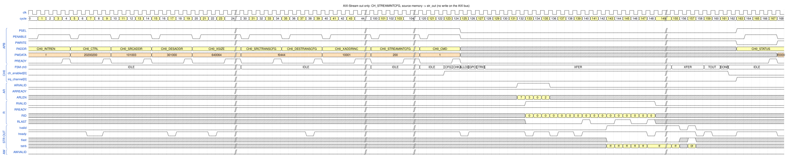
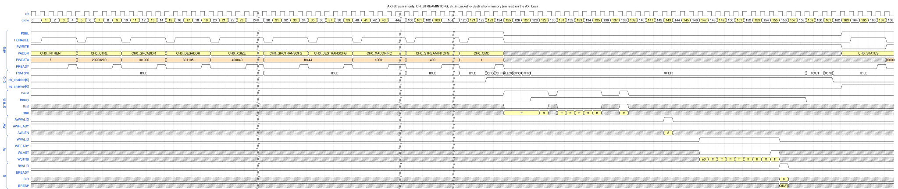
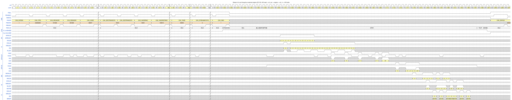

# 7. AXI-Stream

Each channel can have an **AXI4-Stream** pair, `str_out` and `str_in`, to put an **external data engine** in the
data path (compression, filtering, encryption, ...). In this build channels 0 and 1 have stream interfaces.
Test case: `dma_dir_stream_test`. Figure conventions: [README](README.md#how-to-read-the-figures).

## 7.1 Concepts

`CH_CTRL.USESTREAM` (bit 29) enables the stream for a command and `CH_STREAMINTCFG.STREAMTYPE` (bits 10:9) selects
the direction:

| `STREAMTYPE` | Name | Data flow |
|---|---|---|
| `01` | stream **out** only | AXI read → FIFO → `str_out`. No AXI write. |
| `10` | stream **in** only | `str_in` → FIFO → AXI write. No AXI read. |
| `00` | stream **in & out** | AXI read → `str_out` → **external engine** → `str_in` → AXI write |

Rules of the interface (TRM 4.5, 5.5):

* One command is **one packet**: `TLAST` marks the end of the data. A stream-in packet that ends early finishes the
  command (`XTYPE` continue: the destination is left as is; `XTYPE`/`YTYPE` fill: the rest of the destination is
  filled with `FILLVAL`). A packet that is too long is an error.
* **`TSTRB` is all ones except on the beat with `TLAST`**: no gaps inside a packet; an unaligned tail is allowed
  only at the end. There is no `TKEEP` and no `TID`.
* `str_in_flush` is a hint to the engine to send `TLAST` early when the command must stop.
* Wrap modes cannot be combined with stream in, and flow-control triggers cannot be combined with stream
  (configuration error, [Chapter 9](09_error_handling.md)); command triggers and trigger output work normally.

## 7.2 Stream out only: memory → `str_out`

The 100 bytes at `0x101003` are read from memory and pushed to the stream; nothing is written on AXI.

*Figure `stream_out` – source: [`wavejson/stream_out.json`](wavejson/stream_out.json).*

**Configure**

| Register | Value | Meaning |
|---|---|---|
| `CH_CTRL` | `0x20200200` | normal copy + **`USESTREAM` = 1** (bit 29) |
| `CH_STREAMINTCFG` | `0x200` | `STREAMTYPE` = `01`: stream out |
| `CH_SRCADDR` | `0x101003` | unaligned source |
| `CH_XSIZE` | `0x640064` | 100 elements (bytes) |
| `CH_DESADDR` | `0x301000` | **not used** (the destination is the stream) |

**Walk-through**

| Cycle | Event |
|---|---|
| 124 | `CH_CMD` = 1; `XFER` from 128 |
| 132–135 | four `AR`: `0x101003` (`ARLEN` 7, 8 beats), `0x101040` (`ARLEN` 3, 4 beats), `0x101060` (`ARSIZE` 2, 1 beat), `0x101064` (`ARSIZE` 0, 3 beats) – together exactly 100 bytes |
| 133–148 | 16 `R` beats |
| 143 | **`str_out_tvalid` ↑** – 11 cycles after the first `AR`: the data had to pass the FIFO |
| 143–155 | 12 full beats (`tstrb` = `ff`). The receiver is a VIP with random `TREADY` (about 80 %): `tready` = 0 in cycle 148 holds `tvalid` and the data unchanged for one cycle. |
| 156, 157 | `tvalid` pauses for one cycle, then the **last beat**: `tstrb` = `0f` (4 valid bytes: 12 × 8 + 4 = 100), **`tlast` = 1** |
| 159, 161, 162, 163 | `TOUT`, `DONE`, `ch_enabled` ↓, `irq_channel` ↑ |

The `AW` row stays low: the destination of this command is the stream. Reads are limited by the FIFO space exactly
as in Chapter 3; if the receiver stops asserting `TREADY`, the FIFO fills up and the DMA stops issuing reads.

## 7.3 Stream in only: `str_in` → memory

A packet of 64 bytes arrives on the stream and is written to `0x301105` (unaligned).

*Figure `stream_in` – source: [`wavejson/stream_in.json`](wavejson/stream_in.json).*

**Configure**: `CH_CTRL` = `0x20200200`, `CH_STREAMINTCFG` = `0x400` (`STREAMTYPE` = `10`: stream in),
`CH_DESADDR` = `0x301105`, `CH_XSIZE` = `0x400040` (64 elements); `CH_SRCADDR` is not used.

| Cycle | Event |
|---|---|
| 124 | `CH_CMD` = 1 |
| 125 | `str_in_tvalid` = 1: the packet is already waiting at the engine, but **`str_in_tready` = 0** – the channel is not in `XFER` yet |
| 128 | FSM `XFER`, **`str_in_tready` ↑**; the first beat is accepted in 128 |
| 128–138 | 8 stream beats (64 bytes) accepted in 128, 129, 131–135 and 138; the engine pauses `tvalid` in 130 and 136–137; the last beat has **`TLAST` = 1** (138) |
| 143 | `AW` `0x301105`, `AWLEN` = 8 (9 beats): issued when all 64 bytes are in the FIFO, 5 cycles after `TLAST` |
| 147–155 | 9 `W` beats |
| 156 | `B` |
| 159, 161, 162, 163 | `TOUT`, `DONE`, `ch_enabled` ↓, `irq_channel` ↑ |

The AR row is idle: nothing is read from memory. Notes:

* The 64 bytes start at lane 5, so the 9 write beats carry 3 + 7 × 8 + 5 bytes.
* **`str_in_tready` follows the FIFO space** (`si_tready` in `dma_channel.sv`): it is 1 only in `XFER` (or while
  flushing) and when the FIFO can take a whole bus word.
* `TLAST` is meaningful only together with `tvalid`; the VIP drives random values while `tvalid` = 0, which is why the
  figure shows `tlast` only for valid beats.

## 7.4 Stream in and out through an external engine (2D, with fill)

The DMA sends the source data to the engine and writes back whatever the engine returns. The test uses an engine that
returns the **same bytes** it received.

*Figure `stream_inout` – source: [`wavejson/stream_inout.json`](wavejson/stream_inout.json).*

**Configure**

| Register | Value | Meaning |
|---|---|---|
| `CH_CTRL` | `0x20203200` | `USESTREAM`, `XTYPE` = 1 (continue), **`YTYPE` = 3 (fill)** |
| `CH_STREAMINTCFG` | `0x0` | `STREAMTYPE` = `00`: in & out |
| `CH_SRCADDR` / `CH_DESADDR` | `0x101500` / `0x301600` | |
| `CH_XSIZE` | `0x80007` | source line 7 bytes, destination line 8 bytes |
| `CH_YSIZE` | `0x60005` | source 5 lines, destination 6 lines |
| `CH_YADDRSTRIDE` | `0x100010` | 16 bytes on both sides |

The source is 5 lines × 7 = 35 bytes, the destination area is 6 lines × 8 = 48 bytes, so the engine's 35 bytes
fill 4 lines and 3 bytes of the fifth; the rest must be filled with `FILLVAL`.

| Cycle | Event |
|---|---|
| 124 | `CH_CMD` = 1; `CFG`, `CHK`, **`MUL`** (125–132), `ALLOC`, `GPO`, `CTRIG`, `XFER` (136) |
| 140–149 | ten `AR` in pairs per line: `0x101500` (4 bytes) and `0x101504` (3 bytes), then `0x101510` ... – one pair per source line |
| 163–172 | **stream out**: the 35 source bytes are sent as one packet (`tvalid` pulses; the last beat with `TLAST`) |
| 174–181 | **stream in**: the engine returns the packet (`str_in_tvalid`, `TLAST` on the last beat) |
| 179, 182, 183, 184, 186 | `AW` `0x301600`, `0x301610`, `0x301620`, `0x301630`, `0x301640`: four full destination lines and the data part of line 5 |
| 188, 189 | `AW` `0x301643` (the remaining 5 bytes of line 5: **fill**, `WSTRB` `f8`) and `AW` `0x301650` (line 6: 8 bytes of **fill**) |
| 185–195 | seven `B` responses |
| 198, 200, 201, 202 | `TOUT`, `DONE`, `ch_enabled` ↓, `irq_channel` ↑ |

What to notice:

* The read side finishes long before the stream returns (cycle 149 versus 172): the FIFO holds the data while the
  engine processes it; reads and writes are decoupled even through the external engine.
* The destination bytes after the packet are generated inside the DMA: `1717171717000000` and `1717171717171717`
  (`FILLVAL[7:0]` = `0x17` replicated), exactly as in [Chapter 4](04_2d_wrap_fill.md).
* If the engine returns **more** data than the destination can hold (`STRINOVERRUN`), finishes its packet
  **before** the DMA has sent all stream-out data (`STRINEARLYTERM`), or sends a wrong `TSTRB` (`STRINTSTRBERR`), the
  DMA stops with a stream error (`STREAMERR` in `CH_ERRINFO`) and asserts `str_in_flush`; see
  [Chapter 9](09_error_handling.md) and `dma_stream_err_test`.
