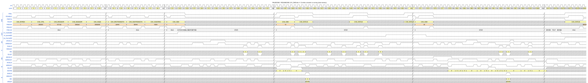
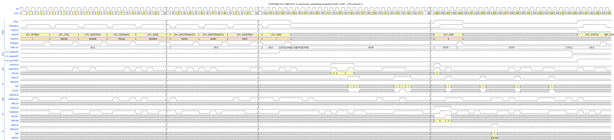
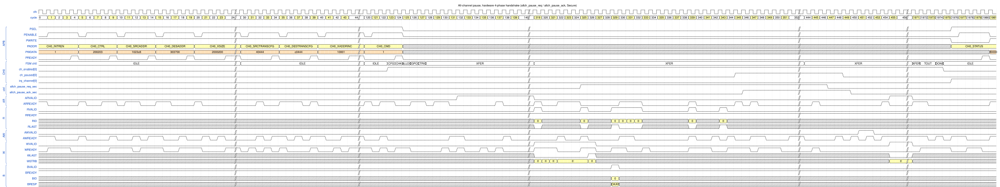
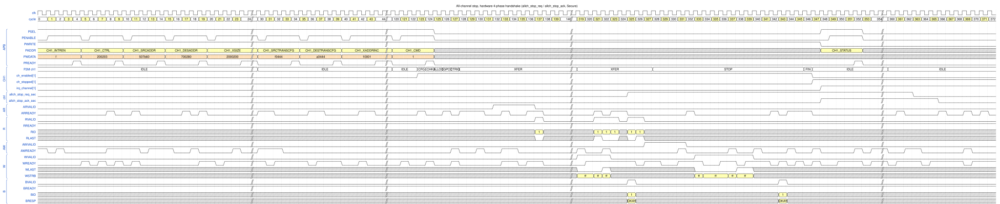
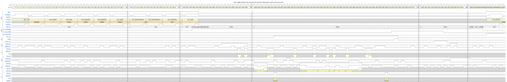

# 8. Channel control: pause, resume, stop, all-channel control and CTI

A running command can be **paused and resumed**, **stopped**, or **disabled** by software, by hardware pins, or by a
debugger. Test case: `dma_ctrl_test`, which uses **slow memory** (`ARREADY` / `AWREADY` about 30 %, `WREADY`
about 50 %, read and write response delays up to 6 cycles) so that the commands are long enough to interrupt.
That is why the `READY` rows are not constantly high in this chapter. Figure conventions:
[README](README.md#how-to-read-the-figures).

## 8.1 Overview

| Control | Source | Effect |
|---|---|---|
| `PAUSECMD` / `RESUMECMD` | `CH_CMD` bits 4 / 5 | Freeze / continue one channel. The channel stays enabled. |
| `STOPCMD` | `CH_CMD` bit 3 | Cancel the command (and the rest of a command chain). Ends in `STAT_STOPPED`. |
| `DISABLECMD` | `CH_CMD` bit 2 | Finish the **current** command normally, but do not restart or link (ends in `STAT_DISABLED`). |
| All-channel pause / stop (SW) | `ALLCHPAUSE`, `ALLCHSTOP` in `NSEC_CTRL` / `SEC_CTRL` | Same as `PAUSECMD` / `STOPCMD` for every channel of the security domain. |
| All-channel pause / stop (HW) | pins `allch_pause_req_*` / `allch_stop_req_*` | Same, with a 4-phase `req` / `ack` handshake. |
| CTI halt / restart | pins `halt_req`, `restart_req`, `halted` | Pause all channels for a debugger and resume them afterwards. |
| `DONEPAUSEEN` | `CH_CTRL` bit 24 | Automatic pause when `STAT_DONE` is set ([Chapter 5](05_command_linking_restart_autoboot.md)). |

All pause sources are combined (`u_pause`, `c_pause`, `donepause` in `dma_channel.sv`); the channel is paused as long
as at least one is active. In every case the DMA stops at **burst granularity**: bursts that already left the channel
finish, no new burst is issued, and the status is reported only when the bus is quiet.

## 8.2 `PAUSECMD` and `RESUMECMD`

*Figure `pause_resume` – source: [`wavejson/pause_resume.json`](wavejson/pause_resume.json).*

**Configure**

| Register | Value | Meaning |
|---|---|---|
| `CH_CTRL` | `0x200203` | 64-bit elements |
| `CH_SRCADDR` / `CH_DESADDR` | `0x1071A0` / `0x3002E0` | |
| `CH_XSIZE` | `0x2000200` | 512 elements = 4096 bytes |
| `CH_SRCTRANSCFG` / `CH_DESTRANSCFG` | `0xA0444` / `0x80444` | `MAXBURSTLEN` 10 / 8 |
| `CH_CMD` | `0x1`, later `0x10` (PAUSECMD), `0x20` (RESUMECMD) | |

**Walk-through**

| Cycle | Event |
|---|---|
| 124 | `CH_CMD` = 1; `XFER` from 128; the transfer runs (middle cut by `//`) |
| 429 | CPU writes `CH_CMD` = `0x10` (**PAUSECMD**) |
| 431–453 | no new burst is issued, but the bursts already in flight complete: the last `R` beats (`RLAST` in 453), the last `W` beats and `B` in 433. The CPU polls `CH_STATUS` in 434 and 449 and reads 0 – not paused yet. |
| 455 | **`ch_paused[0]` ↑** (`STAT_PAUSED` and `STAT_RESUMEWAIT`). 26 cycles after the request, when the bus is quiet. `ch_enabled[0]` is still 1 and the FSM is still `XFER`. |
| 455 → 973 | **no AXI traffic** (the test bench waits 500 cycles and checks) |
| 973 | `ch_paused[0]` ↓: the `RESUMECMD` write was executed while its APB access was still completing |
| 974 | `CH_CMD` = `0x20` (**RESUMECMD**) completes |
| 975 | `AW` `0x300540` (`AWLEN` = 7) in the very next cycle: the data was waiting in the FIFO; second `AW` in 979 |
| 980–983, 986 | `W` beats; `AR` `0x107480` resumes reading |
| 2472, 2474 | `TOUT`, `DONE` |
| 2475, 2476 | `ch_enabled[0]` ↓, `irq_channel[0]` ↑ |

Pausing does not lose anything: the FIFO content and the address / size registers are kept, `ch_enabled` stays high and
the configuration registers stay read-only. While paused the **address and size registers show the current position**
(approximately; TRM 5.6.4), so software can inspect progress.

## 8.3 `STOPCMD`

*Figure `stop` – source: [`wavejson/stop.json`](wavejson/stop.json).*

**Configure** (channel 1, frame `0x1100`): `CH_CTRL` = `0x200203`, `CH_SRCADDR` = `0x504348`, `CH_DESADDR` = `0x700C50`,
`CH_XSIZE` = `0x2000200` (4096 bytes), `SRC/DESTRANSCFG` = `0x90444` / `0xA0444`, then `CH_CMD` = 1 and later `CH_CMD` = `0x8`.

| Cycle | Event |
|---|---|
| 124 | `CH_CMD` = 1; `XFER` from 128 |
| 425–427 | still transferring (`AR` `0x504560`, `W`, `R`) |
| 429 | `CH_CMD` = `0x8` (**STOPCMD**): FSM `XFER` → **`STOP`** immediately; no new burst is issued |
| 433, 439, 445 | the remaining `R` beats return (`RLAST` in 445); `B` in 435 |
| 448 | FSM **`FIN`**: all responses have arrived |
| 449 | `ch_enabled[1]` ↓, **`ch_stopped[1]`** ↑ (`STAT_STOPPED`), FSM `IDLE` |
| 450 | `irq_channel[1]` ↑ (`INTR_STOPPED`; `CH_INTREN` = `0xF`) |
| 454 | CPU reads `CH_STATUS` = `0x80008` (`STAT_STOPPED` bit 19 + `INTR_STOPPED` bit 3) |

**Stop is not pause.** The command is cancelled: the channel runs `STOP` (no new bursts; wait for **all outstanding
responses**, flush the stream-in packet if any) and then `FIN`, and returns to idle with `STAT_STOPPED` and **no**
`STAT_DONE`. The data that was read but not yet written is discarded. The same `STOP` → `FIN` path is used for errors
([Chapter 9](09_error_handling.md)). A stopped command chain is cancelled completely.

## 8.4 All-channel pause with the hardware handshake

`allch_pause_req_nonsec` / `allch_pause_req_sec` pause **every active channel of that security domain at once**.
The handshake is 4-phase: `req` ↑ → `ack` ↑ (all channels are paused or inactive) → `req` ↓ → `ack` ↓. Channels
enabled while `req` is high pause immediately. Here the Secure pins are used (the build has the Security Extension).

*Figure `allch_pause_hw` – source: [`wavejson/allch_pause_hw.json`](wavejson/allch_pause_hw.json).*

**Configure**: an ordinary 4096-byte copy on channel 0 (`CH_CTRL` = `0x200203`, `CH_SRCADDR` = `0x1023C8`,
`CH_DESADDR` = `0x303700`, `CH_XSIZE` = `0x2000200`); the pause is requested from a pin, not from a register.

| Cycle | Event |
|---|---|
| 124 | `CH_CMD` = 1; the copy runs |
| 325 | `allch_pause_req_sec` ↑ while a transfer is in progress |
| 345 | `ch_paused[0]` ↑: all outstanding transactions finished (20 cycles after the request) |
| 346 | **`allch_pause_ack_sec` ↑**, one cycle after the channel is paused |
| 346 → 447 | the DMA stays paused; no AXI traffic (the pause pin is held for 100 cycles) |
| 447 | `allch_pause_req_sec` ↓: the request is withdrawn |
| 449, 450 | `ch_paused[0]` ↓ (the copy continues), then `allch_pause_ack_sec` ↓ |
| 1975 | `ch_enabled[0]` ↓ at the end of the command |

The acknowledge means "all channels of this domain are paused or inactive" (TRM 4.8.2). The software equivalent is the
`ALLCHPAUSE` bit; it is cleared by writing the `STAT_ALLCHPAUSED` flag (both are covered by the same test, not drawn).

## 8.5 All-channel stop with the hardware handshake

*Figure `allch_stop_hw` – source: [`wavejson/allch_stop_hw.json`](wavejson/allch_stop_hw.json).*

**Configure**: channel 1, `CH_CTRL` = `0x200203`, `CH_SRCADDR` = `0x507B60`, `CH_DESADDR` = `0x700280`,
`CH_XSIZE` = `0x2000200`, `SRC/DESTRANSCFG` = `0xF0444` / `0xA0444`.

| Cycle | Event |
|---|---|
| 123, 124 | `ch_enabled[1]` ↑; `CH_CMD` = 1 |
| 325 | **`allch_stop_req_sec` ↑** |
| 328 | FSM `XFER` → `STOP` (3 cycles later: the request is synchronized) |
| 343 | the last outstanding `B` |
| 346, 347 | `FIN`; **`ch_enabled[1]` ↓ and `ch_stopped[1]` ↑** |
| 348 | **`allch_stop_ack_sec` ↑** (all channels of the domain are stopped or idle) and `irq_channel[1]` ↑ |
| 363 | `allch_stop_req_sec` ↓ |
| 366 | `allch_stop_ack_sec` ↓ |

While the request is high, a channel that software enables is stopped at once. The DMA stops by the same rule as
`STOPCMD`: no new requests, no new triggers, but it waits for all outstanding responses so no AXI transaction is
abandoned.

## 8.6 Cross Trigger Interface: halt and restart for debug

When a debugger halts the CPU it must also halt the DMA, otherwise memory changes under the debugger's feet. The CTI
pins `halt_req`, `restart_req` and `halted` do that. The feature must be enabled first: **`DBGHALTEN`**
(bit 28 of `SEC_CTRL` / `NSEC_CTRL`) is set by software (the first APB write in the figure).

*Figure `cti_halt` – source: [`wavejson/cti_halt.json`](wavejson/cti_halt.json).*

| Cycle | Event |
|---|---|
| 9 | APB write `SEC_CTRL` = `0x10000000`: **`DBGHALTEN` = 1** |
| 14–54 | ordinary 4096-byte copy configuration on channel 0 (`CH_CTRL` = `0x200203`, `CH_SRCADDR` = `0x102080`, `CH_DESADDR` = `0x302888`) |
| 134 | `CH_CMD` = 1; the copy runs |
| 335 | **`halt_req` ↑** (level input from the debug logic) |
| 371 | `ch_paused[0]` ↑ – all channels are paused or not enabled |
| 372 | **`halted` ↑ for exactly one cycle** (pulse) |
| 373 | `halt_req` ↓ (the testbench drops it after seeing `halted`) |
| 423–427 | **`restart_req` pulse** (4 cycles) |
| 426 | `ch_paused[0]` ↓: the channel returns to the state before the halt and continues |
| 2505 | `ch_enabled[0]` ↓ at the end of the command |

The halt request is combined with the hardware and software all-channel pause. After the DMA has halted it **waits for
`restart_req`**; a `restart_req` before a `halt_req`, or a second `halt_req` before the restart, is ignored
(TRM 5.9.3).
