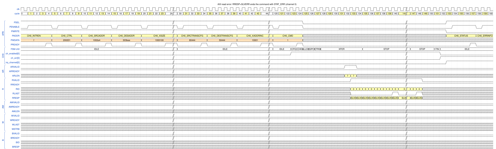
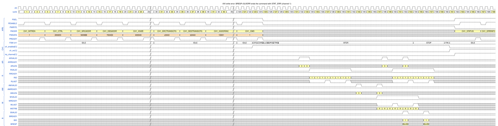
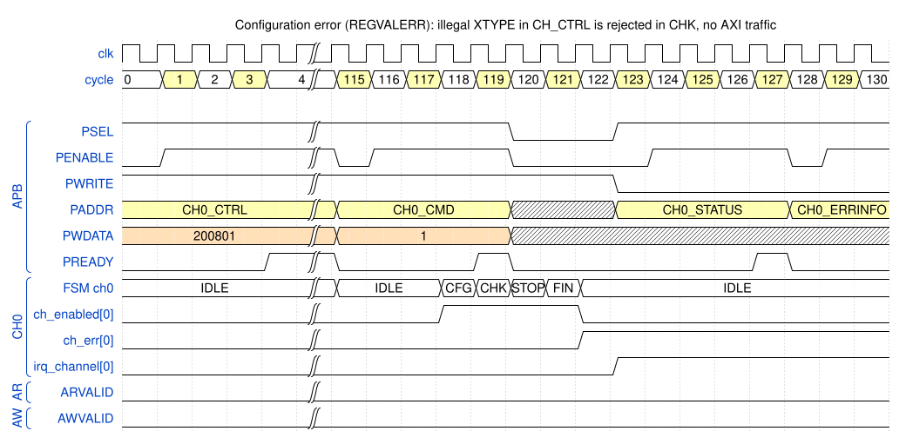

# 9. Error handling

The DMA detects four kinds of errors (TRM 5.6.3): **AXI bus errors**, **configuration errors**, **trigger selection
errors** and **AXI-Stream errors**. Whatever the cause, the channel takes the same path:

```
 error detected ──> STOP (no new bursts, no new triggers, wait for ALL outstanding responses) ──> FIN
                                                                                                   │
        ch_enabled ↓  and  ch_err ↑  (STAT_ERR = 1, INTR_ERR if enabled, irq_channel ↑, CH_ERRINFO valid) ◄┘
```

* The channel is the **only** one that stops; other channels continue (TRM 4.3.5).
* `STAT_ERR` (`CH_STATUS` bit 17) is set when the channel returns to the disabled state, i.e. in the **same cycle as
  `ch_enabled` falls**. This is checked on every error in all simulations ([Chapter 11](11_consistency_report.md)).
* `CH_ERRINFO` explains the cause and is valid while `STAT_ERR` = 1. Writing 1 to `STAT_ERR` clears the flag **and**
  `CH_ERRINFO` (the figures' test reads it back as 0).

Test case: `dma_err_test` (error responses are injected by the AXI subordinate VIP). Figure conventions:
[README](README.md#how-to-read-the-figures).

## 9.1 Error causes in `CH_ERRINFO` (TRM Tables 5-8 and 5-9)

| Bit | Name | Meaning | RTL source |
|---|---|---|---|
| 0 | `BUSERR` | an AXI error response or poison was received (always together with one of bits 16–18) | `e_rdresp`, `e_wrresp`, `e_rdpois` |
| 1 | `CFGERR` | configuration error (always with bits 24–26) | `chk_regval`, `chk_confl`, `e_hdr` |
| 2 | `SRCTRIGINSELERR` | source trigger port not selectable | trigger matrix, state `ALLOCW` |
| 3 | `DESTRIGINSELERR` | destination trigger port not selectable | same |
| 4 | `TRIGOUTSELERR` | trigger output port not selectable | same |
| 7 | `STREAMERR` | stream error (always with bits 19–21) | stream logic |
| 16 | `AXIRDRESPERR` | `RRESP` was SLVERR or DECERR | read data path |
| 17 | `AXIWRRESPERR` | `BRESP` was SLVERR or DECERR | `b_resp[1]` |
| 18 | `AXIRDPOISERR` | `RPOISON` was set | read data path |
| 19 | `STRINTSTRBERR` | invalid `str_in_tstrb` | stream in |
| 20 | `STRINOVERRUN` | more stream-in data than the destination can take | stream in |
| 21 | `STRINEARLYTERM` | stream in finished before stream out | stream in & out |
| 24 | `LINKHDRERR` | invalid command-link header (all zero, or reserved bits 1, 23, 25, 27) | `dma_ch_link` |
| 25 | `REGVALERR` | an illegal register value | `chk_regval` |
| 26 | `CFGCONFLERR` | conflicting settings | `chk_confl` |

**`REGVALERR`** is raised when, for example: `TRANSIZE` is larger than the bus; `XTYPE` / `YTYPE` is 4–7; wrap or
fill is used on a channel without extended features; `DONETYPE` is not 0, 1 or 3; `REGRELOADTYPE` is not one of the
legal values; a trigger type or mode is reserved; a trigger select is out of range; `STREAMTYPE` is `11`.
**`CFGCONFLERR`** is raised when settings contradict each other, for example flow-control triggers on a 2D command or
together with the stream interface, source flow control combined with wrap, wrap or fill XTYPE with stream in, a
template together with 2D (`chk_confl` in `dma_channel.sv` has the complete list, derived from TRM 5.9.2).

## 9.2 AXI read error (`RRESP` = SLVERR)



*Figure `err_read` – source: [`wavejson/err_read.json`](wavejson/err_read.json).*

**Configure**

| Register | Value | Meaning |
|---|---|---|
| `CH_CTRL` | `0x200201` | `TRANSIZE` = 1 (16-bit elements) |
| `CH_SRCADDR` / `CH_DESADDR` | `0x1002E4` / `0x303BEE` | |
| `CH_XSIZE` | `0x1000100` | 256 elements = 512 bytes |
| `CH_SRCTRANSCFG` / `CH_DESTRANSCFG` | `0x80444` / `0x50444` | |
| (test bench) | | the source address range is configured to return **`RRESP` = SLVERR** on every read |

**Walk-through**

| Cycle | Event |
|---|---|
| 124 | `CH_CMD` = 1; `XFER` from 128 |
| 132, 133 | two `AR` (`0x1002E4`, `0x100320`, `ARLEN` = 7) |
| 133 | first `R` beat with `RRESP` = **SLVERR** |
| 135 | FSM `XFER` → **`STOP`** (2 cycles after the first bad beat) |
| 133–148 | all 16 beats of the two issued bursts are still received (`RLAST` in 140 and 148) |
| – | **no `AW` / `W` at all**: the bad data is never written |
| 151 | FSM `FIN`: no response is outstanding any more |
| 152 | `ch_enabled[0]` ↓ **and** `ch_err[0]` ↑, FSM `IDLE` |
| 153 | `irq_channel[0]` ↑ |
| 157, 162 | CPU reads `CH_STATUS` = `0x20002` (`STAT_ERR` bit 17 + `INTR_ERR` bit 1) and `CH_ERRINFO` = **`0x10001`** (`AXIRDRESPERR` + `BUSERR`) |

The bursts that were already issued are **not abandoned** – AXI does not allow that – so the DMA waits for their data
before it finishes (TRM 5.6.3: "All outstanding transactions are completed, but their data is also discarded").

## 9.3 AXI write error (`BRESP` = SLVERR)



*Figure `err_write` – source: [`wavejson/err_write.json`](wavejson/err_write.json).*

**Configure** (channel 1): `CH_CTRL` = `0x200203`, `CH_SRCADDR` = `0x500988`, `CH_DESADDR` = `0x700430`,
`CH_XSIZE` = `0x400040` (64 elements of 8 bytes), `SRC/DESTRANSCFG` = `0xC0444` / `0xB0444`; the first destination
range returns **`BRESP` = SLVERR**.

| Cycle | Event |
|---|---|
| 124 | `CH_CMD` = 1 |
| 132, 133 | `AR` `0x500988`, `0x5009A8` (`ARLEN` 3, `ARID` 1); `R` in 134–141 |
| 143, 147 | `AW` `0x700430`, `0x700450` (`AWLEN` 3) |
| 147–154 | the 8 `W` beats of the two bursts (`WLAST` in 150 and 154) |
| 148, 152 | two more `AR` (`0x5009C8`, `0x5009E8`): reading continues in parallel with writing |
| 152 | `B` with `BRESP` = **SLVERR** (first burst) |
| 154 | FSM `XFER` → **`STOP`** (2 cycles after the bad response) |
| 156 | `B` of the second burst, also SLVERR |
| 150–157 | the data of the two reads that were already issued is still received (`RLAST` in 157); **no new `AR` / `AW` after 154** |
| 160 | `FIN` |
| 161 | `ch_enabled[1]` ↓ and `ch_err[1]` ↑ |
| 162 | `irq_channel[1]` ↑ |
| 166, 171 | `CH_STATUS` = `0x20002`; `CH_ERRINFO` = **`0x20001`** (`AXIWRRESPERR` + `BUSERR`) |

Unlike the read error, part of the data has already been written when the error is reported: writes are posted and the
response arrives after the data. The DMA can only stop issuing and wait.

## 9.4 Configuration error (`REGVALERR`): no bus access at all



*Figure `err_cfg` – source: [`wavejson/err_cfg.json`](wavejson/err_cfg.json).*

**Configure**: `CH_CTRL` = `0x200801`. Bits 11:9 = `100` is **`XTYPE` = 4**, an illegal value (only 0 to 3 exist);
`TRANSIZE` = 1. All other registers keep legal values.

| Cycle | Event |
|---|---|
| 118 | `ch_enabled[0]` ↑, FSM `CFG` |
| 119 | the `CH_CMD` write completes; FSM **`CHK`**: the value check finds the illegal `XTYPE` |
| 120 | FSM **`STOP`**; the FSM does **not** go through `ALLOC`, `GPO`, `CTRIG`, `XFER` |
| 121 | `FIN` |
| 122 | `ch_enabled[0]` ↓ and `ch_err[0]` ↑ |
| 123 | `irq_channel[0]` ↑ |
| 127, 132 | `CH_STATUS` = `0x20002`; `CH_ERRINFO` = **`0x02000002`** (`REGVALERR` bit 25 + `CFGERR` bit 1) |

`ARVALID` and `AWVALID` stay low for the whole figure: configuration errors are detected **before any bus transaction**
(TRM 5.6.3: "No bus transfers are initiated when a configuration error is detected"). The whole error costs 4 cycles.

## 9.5 Other errors (not drawn)

| Error | How it behaves | Test |
|---|---|---|
| Read poison (`RPOISON`) | like a read error: `AXIRDPOISERR` + `BUSERR` | `dma_err_test` |
| Trigger selection errors | detected in `ALLOCW`; the port is owned by another channel, selected twice, or has a different security attribute; `SRCTRIGINSELERR` / `DESTRIGINSELERR` / `TRIGOUTSELERR` | `dma_err_test`, `dma_trig_mtx_test` |
| Link header error | invalid header word → `LINKHDRERR` + `CFGERR` | `dma_link_err_test` |
| Stream errors | `STRINTSTRBERR`, `STRINOVERRUN`, `STRINEARLYTERM` + `STREAMERR`; `str_in_flush` discards the rest of the packet | `dma_stream_err_test` |
| Security violation | access with insufficient rights reads as zero / is ignored, or returns `PSLVERR` and raises `irq_sec_viol_err` | `dma_sec_test` |
