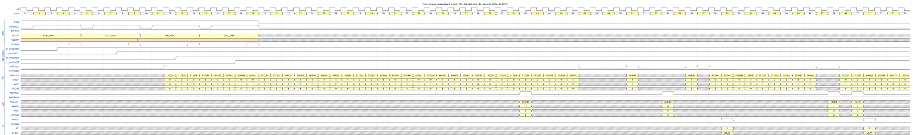
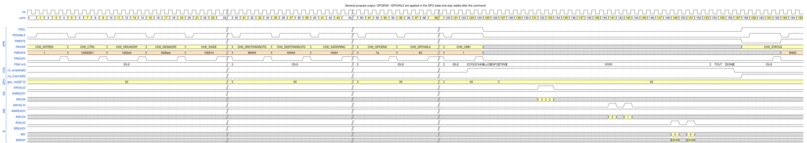
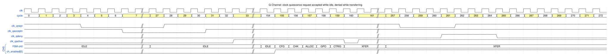
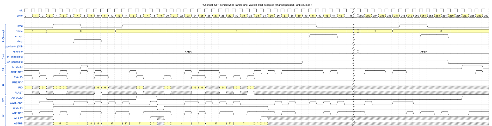

# 10. Arbitration, general purpose outputs and low-power interfaces

Test cases: `dma_multi_ch_test`, `dma_gpo_irq_test`, `dma_lpi_test`.
Figure conventions: [README](README.md#how-to-read-the-figures).

## 10.1 Arbitration between channels

### How it works

All channels share the AXI port(s). The bus interface unit (`dma_biu.sv`) has, **per port and per direction**
(`AR` and `AW`), one arbiter (`dma_lrg_arb.sv`, TRM 5.8.2) with two layers:

1. **Fixed priority layer** – only the requesters with the **highest `CHPRIO`** (`AxQOS`) take part.
2. **Least-recently-granted (LRG) layer** – among equal priorities the channel that was granted **longest ago** wins
   (the history is a precedence matrix, updated only when a grant is accepted).

Arbitration happens **per burst**, so a high-priority channel can take consecutive bursts and starve a low-priority
channel – the software chooses the priorities (TRM 5.8). A channel *requests* arbitration for a read when its next
burst is ready **and the FIFO has room for the response**; for a write when its next burst is ready **and the FIFO holds
the whole burst** (TRM 5.8.1). `AxID` is the channel number, so responses return to the right channel and each
channel's responses stay in order. Command-link reads use the same arbitration.

### Four channels started back to back

*Figure `multi_ch_arb` – source: [`wavejson/multi_ch_arb.json`](wavejson/multi_ch_arb.json).*

Four random commands (one per channel, all registers programmed before the figure starts) are enabled in turn.
Their `CHPRIO` values, visible as `ARQOS` / `AWQOS`:

| Channel | Frame | `CHPRIO` | `ARID` / `AWID` |
|---|---|---|---|
| 0 | `0x1000` | 0 | 0 |
| 1 | `0x1100` | 5 | 1 |
| 2 | `0x1200` | 9 | 2 |
| 3 | `0x1300` | 8 | 3 |

`CH_CMD` = 1 is written for channels 0, 1, 2, 3 in cycles **4, 9, 14, 19** (`ch_enabled[n]` rises in 3, 8, 13, 18).

| Cycle | What the arbiter does |
|---|---|
| 12–16 | only channel 0 has started: five consecutive `AR` with `ARID` = 0, `ARQOS` = 0 |
| 17–21 | channel 1 (`ARQOS` 5) is in `XFER` → it **wins over channel 0**: five `AR` with `ARID` = 1 |
| 22–27 | channel 2 (`ARQOS` 9) issues its first `AR` in 22 and gets six consecutive grants (`ARID` = 2) |
| 28–34 | channel 2 has no request waiting for a moment, channel 1 continues (seven `AR`) |
| 35, 36 | channel 3 (`ARQOS` 8) is granted **before** channel 1 (`ARQOS` 5) |
| 37, 38–45 | one `AR` of channel 1, then channel 0 (lowest priority) receives eight consecutive grants |
| 42, 54 | first two `AW`: `AWID` = 2, `AWQOS` = 9, `AWLEN` = 11 |
| 68, 70 | `AW` of channel 3 (`AWID` 3, `AWQOS` 8) |
| 59, 71 | `B` with `BID` = 2 |

What to notice:

* **`ARREADY` is always 1**, so one `AR` is accepted every cycle and the order of the `ARID` values is the
  arbitration result. A channel with a higher `ARQOS` is served first whenever it has a request (channel 2 over
  channel 1, channel 3 over channel 1); the lowest priority channel (0) goes through in the gaps.
* **`ARID` = channel number and `ARQOS` = `CH_CTRL.CHPRIO`** for all 5,363 `AR` and `AW` transfers (2,199 on M0, 3,164 on
  M1) of the simulation behind this figure (automatic check, [Chapter 11](11_consistency_report.md)).
* The `R` and `B` beats of the four channels are interleaved on the bus and routed back by ID; no reorder buffer
  is needed because each channel's responses are already in order.
* **Equal priorities** are served in LRG order, which gives each channel a fair share of the *grants*. The measured
  numbers are in [`docs/perf_report.md`](../perf_report.md) §3.7: with address back-pressure (AR `READY` = 20 %) two
  equal-priority channels get **48 % / 52 %** of the grants; `CHPRIO` 15 against 0 gives about **91 % / 9 %** of the port.
  The port reaches 98–100 % utilisation with several channels (the arbiter adds no bubbles).

## 10.2 General purpose outputs (GPO)

GPO pins are extra bits per channel that a command can set, for example to select a memory bank, drive a debug pin or
control the external stream engine. `GPOEN0` selects which bits the command changes, `GPOVAL0` gives their value; the
update uses the formula `new = (old & ~GPOEN0) | (GPOVAL0 & GPOEN0)`.

*Figure `gpo` – source: [`wavejson/gpo.json`](wavejson/gpo.json).*

**Configure** (a normal copy plus):

| Register | Value | Meaning |
|---|---|---|
| `CH_CTRL` | `0x10200201` | **`USEGPO` = 1** (bit 28), `TRANSIZE` = 1, `DONETYPE` = 1 |
| `CH_GPOEN0` | `0x7A` | bits 1, 3, 4, 5, 6 are changed |
| `CH_GPOVAL0` | `0x63` | their new values |

| Cycle | Event |
|---|---|
| 124 | `CH_CMD` = 1 |
| 126 | FSM `GPO` |
| 127 | **`gpo_ch[0]` changes from `0x00` to `0x62`** = `(0x00 & ~0x7A)` OR `(0x63 & 0x7A)` |
| 128–153 | the copy runs; `gpo_ch[0]` stays `0x62` |
| 156, 157, 158 | `DONE`, `ch_enabled` ↓, `irq_channel` ↑ – **`gpo_ch[0]` still `0x62`** |

The value is applied **before the transfer starts** (state `GPO`) and **stays** after the command ends, until another
command changes it (TRM 4.8.1); the current value can be read back from `CH_GPOREAD0`. An empty command that selects
all bits and writes 0 returns the outputs to zero.

## 10.3 Clock Q-Channel

The **Q-Channel** is the standard AMBA low-power handshake with which a clock controller asks the DMA whether the
clock may be stopped. The pins: `clk_qreqn` (input, low = request), `clk_qacceptn` (output, low = accepted),
`clk_qdeny` (output, high = denied), `clk_qactive` (output, the DMA wants its clock). No register is involved.
The DMA **accepts** when it is idle or only waiting for an event, and **denies** when it is active
(`dma_lpi.sv`, TRM 5.9.1.2). `clk_qreqn` passes a 2-flop synchronizer, so the answer comes 3 cycles after the request.

*Figure `lpi_q` – source: [`wavejson/lpi_q.json`](wavejson/lpi_q.json). The second half uses the slow-memory
profile of the test so the 4096-byte copy lasts long enough.*

| Cycle | Pin | Event |
|---|---|---|
| 4 | `clk_qreqn` ↓ | clock controller requests quiescence; the DMA is **idle** |
| 7 | `clk_qacceptn` ↓ | **accepted** – the clock may be gated |
| 28 | `clk_qreqn` ↑ | clock restored (the test holds the accepted state for 20 cycles) |
| 31 | `clk_qacceptn` ↑ | the DMA is running again |
| 32–153 (`//`) | | a 4096-byte command is programmed; `ch_enabled[0]` ↑ in 155, `XFER` in 160 |
| 258 | `clk_qreqn` ↓ | a new request while the DMA is **transferring** |
| 261 | **`clk_qdeny` ↑** | **denied** |
| 262 | `clk_qreqn` ↑ | the controller withdraws the request |
| 265 | `clk_qdeny` ↓ | handshake ends; the transfer was not disturbed |

`clk_qactive` tells the controller that the DMA needs a clock: it is high when the DMA is active or when a wake-up
source arrives (`pwakeup`, a trigger request or a control request), through a path that does not need the clock itself.
A channel that only waits for a trigger counts as "waiting", so a Q-Channel request is accepted in that situation.

## 10.4 Power P-Channel

The **P-Channel** negotiates **power states**: `preq` (request) with `pstate` (the requested state), answered by
`paccept` or `pdeny`; `pactive[n]` tells the power controller which states the DMA currently needs. The DMA supports
**ON** (`pstate` = 8), **WARM_RST** (9), **FULL_RET** (5) and **OFF** (0); any other value is denied
(`dma_lpi.sv`, TRM 5.9.1.1):

* **OFF** is accepted only when **no channel is enabled** (and `DISMINPWR` does not forbid it), otherwise denied.
* **FULL_RET** (retention) is accepted when the DMA is not active and, if a channel only *waits* for an event,
  `IDLERETEN` allows it.
* **WARM_RST** is accepted once **all channels have been paused** (the DMA pauses them first); going back to **ON**
  resumes them.
* **ON** is always accepted.

*Figure `lpi_p` – source: [`wavejson/lpi_p.json`](wavejson/lpi_p.json). A long copy is running (slow-memory profile).*

| Cycle | Pin | Event |
|---|---|---|
| 3, 4 | `pstate` = 0 (OFF), `preq` ↑ | power controller asks to switch **off** while a channel is transferring |
| 7 | **`pdeny` ↑** | **denied** (3 cycles later) |
| 8, 11 | `preq` ↓, `pdeny` ↓ | handshake ends; the DMA keeps running |
| 13, 14 | `pstate` = 9 (WARM_RST), `preq` ↑ | request for warm reset |
| 40 | `ch_paused[0]` ↑ | **all channels pause** once the outstanding bursts are finished |
| 41 | **`paccept` ↑** | **accepted** |
| 42, 45 | `preq` ↓, `paccept` ↓ | handshake ends; the DMA stays paused |
| (gap, about 200 cycles) | | no AXI traffic while in warm reset |
| 247–248 | `pstate` = 8 (ON), `preq` ↑ | request to return to ON |
| 251 | **`paccept` ↑** | accepted |
| 252, 255 | `preq` ↓; `ch_paused[0]` ↓ and `paccept` ↓ | **the channel resumes** |

Pausing in `WARM_RST` uses the same mechanism as `PAUSECMD` ([Chapter 8](08_channel_control.md)): bursts in flight
complete, then the channel is paused; no state is lost. `pactive[8]` (ON) is high whenever the DMA is active, so
the power controller knows not to remove power.
